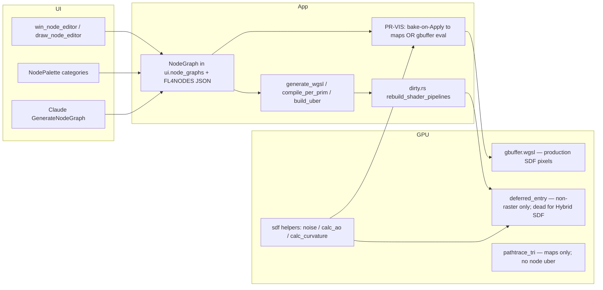
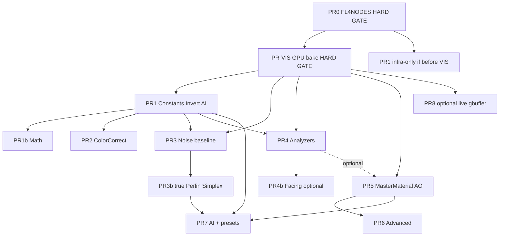

# Procedural Texturing Tool for AZRA — Design Document

| Field | Value |
|-------|--------|
| **Title** | Procedural Texturing Tool (Shader Node Graph Expansion) |
| **Author** | Design (planning phase) |
| **Date** | 2026-07-19 |
| **Status** | **Approved (owner decisions incorporated) — Rev 5** |
| **Scope** | Design approved for implementation; this document is the planning source of truth |
| **Primary surface** | `core_engine/app/src/shader_nodes.rs` (frozen by default in CLAUDE.md; this workstream **explicitly unfreezes** it) |
| **Related docs** | `MATERIAL_SYSTEM_DESIGN.md`, `docs/planning/render/MATERIALS_UX.md`, `CLAUDE.md`, `ARCHITECTURE.md` |

---

## Overview

AZRA already has a working **visual shader node graph** that compiles to WGSL (`NodeGraph::generate_wgsl` / `build_uber_material_fn`), injects into deferred via `dirty.rs::rebuild_shader_pipelines`, and is edited in `win_node_editor.rs`. The owner request is to turn that skeleton into a **procedural texturing tool** with a complete catalog: constant color, full noise suite, richer MasterMaterial output, projections, surface analyzers (AO / curvature), invert, color correction, and expanded math nodes that wrap math already present in WGSL/CPU helpers.

This design **extends the existing graph→WGSL codegen path** (not a new product, not bytecode). It maps each owner category to Existing / Missing / Wrap-existing-GPU / New-math, specifies a node catalog, MasterMaterial strategy, noise strategy, surface-analysis approach (analytical `calc_ao` / `calc_curvature`, not SSAO), codegen, UI, serde rules, tests, and an incremental PR plan.

### Critical product truth (Display Invariant, post-2026-07-14)

**Live `eval_node_material` in deferred is effectively invisible for production SDF geometry.**

| Fact | Implication |
|------|-------------|
| Analytical SDF march display is **deleted** | `pipeline_lite` = floor + background only; no analytical surface hits |
| Default path = **Hybrid + DC mesh raster** | Geometry pixels are triangles in `gbuffer.wgsl` |
| Deferred **skips** material re-eval when `is_raster_pixel` | `eval_node_material` never runs on those pixels (`deferred_entry.wgsl`) |
| Raster writes **no** usable `gbuf_surface_id` | Deferred forces `prim_sid = 0xFFFFFFFF` for raster — cannot resolve prim for node dispatch |
| Analytical PT (`pathtrace_entry.wgsl`) **dropped from build** (file may still exist on disk; not a live consumer) | Production PT is **triangle** (`pathtrace_tri_entry.wgsl`); **no** node-graph uber inject |
| Internal note | *“post-2026-07-14 every geometry pixel is raster”* (`docs/planning/sdf/CACHE_REMESH_512_REVIEW.md`) |

Therefore: shipping catalog + persistence + successful Naga compile **without a visibility path** produces **zero owner-visible shading** on SDF bodies. This is **not** “Object Mode polish until PR8” — it is the **default product path**.

**Key Decision 19 (visibility):** Elevate a **minimal visibility path (PR-VIS)** as a **hard gate** before any catalog PR may claim viewport shading. See § Visibility architecture and PR Plan.

**v1 catalog scope (explicit):** constants, noise suite (Value/FBM/White/Cellular/Ridged/Billow/DomainWarp + **true Perlin/Simplex in PR3b** — no fake labels), MasterMaterial (AO mask socket with real `MatResult.ao` in same PR), projections (math done; body-local on the **visibility** path), analytical surface analyzers, invert, ColorCorrect, math with true arity — all **owner-visible only after PR-VIS**.  
**Owner direction:** the **node-based procedural system is the system of record** for procedural materials. Material DNA is legacy — not the product path (Key Decision 24).  
**Deferred beyond core v1 catalog:** mesh UV input, shared Material-asset graphs (post-catalog), Facing+view_dir (optional), clearcoat lighting consume, triangle-PT native node inject, height→normal utility, live gbuffer eval (PR8).

---

## Background & Motivation

### Current state (verified in codebase)

**Node system** — `core_engine/app/src/shader_nodes.rs` (~1.7k lines):

| Layer | Reality |
|-------|---------|
| Socket types | `Float`, `Vec3`, `Color` |
| Graph model | `Node` + `Connection` + `NodeGraph` (topo-sort → WGSL) |
| Runtime entry | `fn eval_node_material(hit_prim, p, n) -> MatResult` |
| Multi-prim | `build_uber_material_fn` dispatches by **flat prim buffer index** (`hit_prim == N u`) — fragile under SCENE reorder |
| Rebuild | `app/src/dirty.rs::rebuild_shader_pipelines` → `graphics::build_deferred_wgsl(Some(&uber_wgsl))` with `catch_unwind`; **invalidates** PT-tri for lazy rebuild — **does not inject** node uber into PT-tri |
| Host consumers (today) | `deferred_entry.wgsl` only — and **only on non-raster pixels** (`!is_raster_pixel`). Production SDF Hybrid → almost never |
| Dead / not consumers | `pathtrace_entry.wgsl` (**not in build** — may remain on disk; do not wire nodes into it); triangle PT (`pathtrace_tri_entry.wgsl`) has **no** node-graph path |
| Raster (production path) | **`gbuffer.wgsl` / `render/` have ZERO node-graph references** — maps/scalars only. **All SDF geometry pixels go here** under Hybrid + DC mesh |
| UI | `draw_node_editor` + `NodePalette::categories` + `win_node_editor.rs` |
| Presets | 10 `MaterialPresets` (Rust Metal, Marble, …) |
| AI | `ClaudeKind::GenerateNodeGraph` in `app_ai/src/claude.rs` — **substantially desynced** from real `Node` serde |
| Prim field | `SdfPrimitive.node_graph: Option<String>` — **serde-persisted** WGSL string from `generate_wgsl`; sets cold float `[107] has_node_graph` |
| Editable graph | `UiWindowState.node_graphs: HashMap<u32 /*prim_uid*/, NodeGraph>` — **session-only; cleared on project load** (`project_load.rs:498`) |
| Rebuild source of truth | **Only** `ui.node_graphs` (`dirty.rs:228–232`). Stored WGSL string is **not** read on rebuild |

**Existing `NodeType` inventory** (append order in enum — **do not reorder**):

```
TexCoord, ObjectInfo,
Noise, Voronoi,
MathBinary, MathUnary, Remap,
ColorRamp, MixRgb, BrightnessContrast,
SeparateXyz, CombineXyz,
Triplanar, BoxMapping, CylindricalMapping, SphericalMapping, PlanarMapping, UVTransform,
TextureSample, GradientTexture, WaveTexture, MusgraveTexture, BrickTexture,
MaterialOutput
```

Note: **`MaterialOutput` is absent from `NodePalette::categories`** today (only created in default graph / presets). PR1 or PR5 must add an **Output** palette category.

**Math ops today:**

- Binary: Add, Subtract, Multiply, Divide, Power, Min, Max, Modulo  
- Unary: Abs, Negate, Sqrt, Sin, Cos, Fract, Floor, Ceil, Saturate  

**Material output path:**

- `MatResult` (`sdf_material.wgsl:91–97`) = `{ color, roughness, metallic, opacity, emission }` only — **no `ao` field yet**  
- `MaterialOutput` sockets match that set (albedo + rough + metal + opacity + emission)  
- Priority on **non-raster deferred hits only** (legacy code path): DNA still wins if present → node graph → `eval_material`. Under Hybrid SDF those hits almost never run. **Product direction:** node graph + PR-VIS maps is the procedural system; **do not invest** in DNA as a texturing path (KD 24)  
- Lighting AO today: deferred calls **`calc_ao(p, n)`** (`sdf_material.wgsl:22–31`, quality-scaled 3/5/8 samples) then multiplies ambient with `final_ao * ssao_f` (and lit path uses `lit_ao_only * lit_ssao`)

**GPU helpers already available (reuse, do not reimplement blindly):**

| Helper | Location | Use |
|--------|----------|-----|
| `hash31`, `noise3`, `fbm3` | `sdf_prim_eval.wgsl` (LEGACY_NOISE) | Value noise + FBM (current Noise node uses `fbm3`; octaves capped `min(octaves, 6u)`) |
| `noise_3d_wgsl`, `fbm_wgsl` | `sdf_prim_eval.wgsl` | Surface modifiers; Musgrave node already calls `fbm_wgsl` |
| `noise3d_gpu`, `fbm3d_gpu` | `sdf_prim_eval.wgsl` / `volume_bake.wgsl` | **Lacunarity/gain FBM** — prefer for expanded Noise Fbm |
| `calc_curvature` | `sdf_prim_eval.wgsl` CURVATURE | 7× `scene_sdf` Laplacian |
| **`calc_ao`** | **`sdf_material.wgsl:22–31`** (SHADOW_AO) | **Primary analytical AO** — multi-sample along normal; quality-scaled |
| DNA geo inputs | `dna_read_input` (curv, cavity, slope, view angle, noise, Y, thickness) | Pattern for Curvature/Cavity/Slope nodes |
| `noise3d` / `fbm_noise` | `post_process.wgsl` | Post only — **not** in material shared path |
| SSAO | `render/src/ssao.wgsl` + `ssao_factor` in deferred | Screen-space; **not** a material-graph input |

**Coordinate space (verified):**

- `TexCoord` emits `let n{id}_pos = p` where deferred reconstructs **`p` / `lit_p` as world-space** camera-ray hits.  
- MATERIALS_UX E2 moved **texture map** triplanar to **body-local** so maps stick when a body moves (zero rebake).  
- Procedural graphs that sample world `p` will **slide under body transform** — product inconsistency with map materials.

**Materials (related, not the same system):**

- Graph `NodePayload::Material` + `MaterialId` + `PbrMaterial` (maps, clearcoat, SSS, sheen, …)  
- Texture maps / triplanar live on **raster** path (`gbuffer.wgsl`) and shared material editor (`MATERIALS_UX.md` E3/E4)  
- Procedural **node graphs are per-prim authoring graphs**; after PR-VIS Apply they **write map slots** on a graph Material (preferred). Deferred uber remains compile/validation only under Hybrid SDF.  

### Pain points

1. **Incomplete catalog** vs owner ask (constants, noise types, invert, color correct, surface analyzers, MasterMaterial).  
2. **Voronoi is a stub** (uses `fbm3` / floor-dot, not cellular distance — `shader_nodes.rs:603–608`).  
3. **Procedural look dies on reload (worse than “editor wiped”):**  
   - Editable `ui.node_graphs` cleared on load.  
   - `prim.node_graph: Option<String>` **is** persisted (full WGSL) and sets `has_node_graph`.  
   - But `rebuild_shader_pipelines` **only** builds uber from `ui.node_graphs` — after load, maps empty → uber fallback → `eval_material` → **look lost**.  
   - The stored string is a **presence flag + dead cache**, not a runtime compiled cache. Pre-FL4NODES saves cannot re-edit or re-show the graph.  
4. **Master surface is thin** — no normal / AO / clearcoat / height sockets; `MatResult` is 5 fields.  
5. **Visibility gap (P0 product):** Production SDF is DC-mesh raster; deferred node eval is skipped for `is_raster_pixel`; triangle PT has no node inject. **Catalog without PR-VIS = invisible tool.**  
6. **`shader_nodes.rs` is frozen** by default — needs explicit unfreeze policy for this stream.  
7. **AI prompt is badly desynced** (correctness bug, not polish): wrong field names (`position`/`math_op`/`inputs` vs real `pos`/`math_binary_op`/`input_defaults`), missing projection + TextureSample types, MaterialOutput sockets wrong (`base_color`/`normal` vs Albedo/Roughness/…), lists nonexistent `Smoothstep` on MathUnary.  
8. **World-space sampling on the dead deferred path** vs body-local maps on the live raster path (`local_position` in `gbuffer.wgsl`).  
9. **Codegen panics on expanded sockets** if old `input_defaults` is shorter than new socket count (unchecked `[i]` indexing).

---

## Goals & Non-Goals

### Goals

1. Fill the **v1 catalog** (color, noise, MasterMaterial AO mask, projections, surface analysis via `calc_ao`/`calc_curvature`, invert, color correction, math) as first-class graph nodes.  
2. Prefer **wrapping existing WGSL helpers** over new GPU bindings where possible.  
3. Preserve **append-only** `NodeType` / op enums and old-graph deserialize (**JSON** for `Node` field evolution — see Key Decision 13).  
4. Keep **codegen** architecture (`gen_node_wgsl` → WGSL); evaluation must run on the **raster-visible path** (PR-VIS), not only dead deferred non-raster hits.  
5. Ship incrementally: each PR merges usable pieces without unfinished half-systems.  
6. Fix **graph persistence** so graphs **re-edit and re-render** after save/load (**PR0 hard gate**).  
7. Ship **PR-VIS (visibility hard gate)** so owners see procedural shading on Hybrid SDF before catalog PRs claim viewport success.  
8. Document MasterMaterial vs `PbrMaterial` asset vs `MaterialOutput` clearly.  
9. Defensive codegen for socket expansion; body-local sampling on the **visibility** path (parity with maps).

### Non-Goals (this program)

- Substance Designer full parity (absolute graphs, MDL, multi-output texture baker suite as product).  
- Bytecode / interpreter runtime for materials (rejected for brushes; same concern).  
- **Live per-pixel gbuffer / deferred node eval as the required v1 viewport path** — that is **optional PR8**, not required for the tool. **v1 primary visibility = PR-VIS bake-on-Apply maps** (Key Decisions 5/19).  
- Reviving or expanding **Material DNA** as a peer procedural system; DNA stays legacy/compat-only (owner: node base is the system). Map slots remain the raster carry path — PR-VIS **authors** them from graphs.  
- New render path / fused raymarch (Display Invariant).  
- Making SSAO a material-node input.  
- Full clearcoat/SSS/anisotropy **lighting** rewrite in deferred (MasterMaterial may *emit* fields in PR6).  
- Editing frozen `compute.wgsl` (dead).  
- Recovering editable structure from pre-FL4NODES WGSL-only saves (impossible for multi-prim uber fidelity).  
- Fake “Perlin” UI that is only value noise (No Hacks).  
- Exact 3D-noise fidelity under a single 2D triplanar layer (approximation accepted in v1 — see § Fidelity).  

---

## Gap Analysis Matrix

| Owner category | Existing | Missing | Wrap-existing-GPU | New-math / New-codegen |
|----------------|----------|---------|-------------------|------------------------|
| **1. Basic Color** | Color defaults on Mix/Ramp/Output; no dedicated constant nodes | `ConstantColor`, `ConstantValue` | N/A (constants are literals in WGSL) | Emit `let n{id}_col = vec3(...)` / float literal |
| **2. All noise types** | `Noise` = FBM via `fbm3`; `MusgraveTexture` hybrid via `fbm_wgsl`; `Voronoi` **stub** | Value, White, Cellular, Ridged, Billow, DomainWarp; **true Perlin/Simplex (PR3b)**; lac/gain/seed | `noise3`/`fbm3`/`fbm3d_gpu`/`hash31` + new gradient helpers | Ridged/billow/warp/cellular; **true Voronoi**; **real** Perlin/Simplex host fns in PR3b (no fake label) |
| **3. MasterMaterial** | `MaterialOutput` → 5 `MatResult` fields | AO (+ later normal/height/clearcoat) | Fallthrough defaults | Expand `MatResult.ao` **in same PR as AO writeback**; label MasterMaterial |
| **4. Projection types** | Triplanar, Box, Cyl, Sphere, Planar, UVTransform (math done) | Mesh UV (defer); product sampling via **PR-VIS bake domain** | Map path body-local reference | Bake samples in **body-local** for TexCoord/projections; no deferred signature for v1 |
| **5. Analyze surface** | DNA uses `calc_curvature`, cavity; lighting uses **`calc_ao`** | Graph nodes: Curvature, Cavity, **AO via `calc_ao`**, Slope | **`calc_ao`**, `calc_curvature` at **world** field space | Dual-space bake; CSE on world `p`; **do not** sample SSAO |
| **6. Invert** | Unary Negate only on float | Invert float (1−x), Invert color (1−rgb) | N/A | Dedicated Invert + MathUnary `OneMinus` |
| **7. Color Correction** | BrightnessContrast | HSV adjust, Gamma, Exposure, Saturation (no separate HSV split nodes v1) | N/A | ColorCorrect + HSV preamble helpers |
| **8. Math nodes** | MathBinary/Unary/Remap | Dot, Cross, Length, Normalize, Clamp, Compare, OneMinus, true Lerp/Smoothstep (ternary) | Built-in WGSL ops | Append true binary/unary ops; `Clamp`/`MixFloat`/`VectorMath` for multi-arg |

**Projection verdict:** projection **math** is complete. Product sampling = **PR-VIS body-local bake domain** (parity with MATERIALS_UX maps). Mesh UV remains deferred.

---

## Proposed Design

### Architecture (keep codegen)



**Decision:** Stay on string WGSL codegen. No bytecode.  
**Evaluation surface that owners see:** **PR-VIS** (bake-on-Apply maps sampled in `gbuffer.wgsl`, body-local — **chosen primary**).  
**Deferred uber inject:** keep for Naga validation, future non-raster hits, and compile of generated WGSL — **not** the product viewport path for Hybrid SDF.  
**Triangle PT:** samples raster materials/maps only; node graphs not in PT-tri today (same visibility class as pre-PR-VIS gbuffer).

### Visibility architecture (PR-VIS — hard gate)

#### Why deferred-only fails

```text
Owner Hybrid SDF body
  → DC mesh extract (body-local verts)
  → raster gbuffer.wgsl (maps / scalars; local_position available)
  → deferred is_raster_pixel == true
  → SKIP eval_node_material / DNA re-eval
  → owner never sees node graph
```

#### Chosen approach: **Bake-on-Apply → existing material maps** (Key Decision 19)

| | Bake-on-Apply (chosen) | Live gbuffer inject of `eval_node_material` | Deferred re-eval on raster pixels |
|--|------------------------|---------------------------------------------|-----------------------------------|
| Display Invariant | Respects triangles-only Object Mode | Respects | Respects lighting pass |
| Body-local | **Free** — bake in body-local space; sample with existing triplanar (`p_local`) | Free (`in.local_position`) | Need prim/body id on raster (surface_id **not** written) |
| scene_sdf nodes (Curvature/AO) | Eval at bake time with full GPU/CPU field access | gbuffer has **no** prim buffer / `scene_sdf` today | Needs valid prim_sid — **stale/sentinel today** |
| BGL / raster shader | **Zero new gbuffer bindings** — uses `MaterialTextureArray` | Large: prim buffer + uber inject into `render` crate | Deferred already has prim buffer; needs surface id plumbing |
| Latency | On **Apply** only (already Apply-gated) | Every frame cost | Every frame on covered pixels |
| Multi-prim body | Bake **per prim** into slots **or** bake **active prim** / merged graph policy (v1: one graph per body primary prim) | Needs per-pixel prim id | Same |

**v1 bake policy (concrete):**

1. On **Apply** (and on load after FL4NODES restore): for each prim with a `NodeGraph`, enqueue a bake job (see Materials integration contract).  
2. **Bake engine (owner decision):** **GPU compute** reusing generated `eval_node_mat_*` WGSL + prim buffer + `scene_sdf` over a MAP_RES² layout. Dual-space entry: `eval_bake(hit_prim, p_local, p_world, n_world)`. CPU FieldEvaluator = emergency fallback only — **not** the v1 plan of record.  
3. **Dual-space invariant** (mandatory):  
   - `p_tex` / TexCoord / Noise / projections / patterns = **body-local**  
   - `p_field` for `scene_sdf` / `calc_curvature` / `calc_ao` = **world** = `BodyTransform::local_to_world(p_tex)`  
   - Normals for `calc_ao`: body-local geometric normal → **world**  
4. Channels: **albedo, roughness, metallic** (emission optional). Height/normal later.  
5. Output resolution: **`MAP_RES` (1024)²** RGBA8 per layer — matches `material_textures.rs`.  
6. Map projection = **Box/triplanar**, strength=1, `uv_scale` from graph default.  
7. **Albedo tint contract:** full procedural albedo bake → scalar **albedo = white (1,1,1)**; rough/metal strength=1 + data-map encode.  
8. **Multi-prim:** v1 = first graph-bearing prim / body-representative material (`RasterMaterial::from_pbr`).  
9. **Deferred uber:** Naga validation only.  
10. **Triangle PT:** sees baked maps automatically.

#### Dual-space bake (detail)

```text
for each texel (u,v) in MAP_RES²:
  p_local = body_local_from_uv(u, v)     // planar policy: see Fidelity
  p_world = body.local_to_world(p_local)
  n_world = body.rotate_normal(n_local)  // or geometric from mesh if available
  // Generators / TexCoord / projections read p_local
  // Curvature / Cavity / AmbientOcclusion / scene_sdf read p_world (+ n_world for AO)
  write albedo/rough/metal outputs
```

CSE for curvature/AO uses **`p_world`** (and shared `_az_curv` / `_az_ao` once per texel).

#### 3D → 2D fidelity limit (v1)

Production sampling = **one 2D layer per channel**, triplanar-projected from body-local position (same texture on three axes). True 3D FBM/cellular `f(p)` **cannot** be represented exactly by one 2D image.

| Content | Fidelity after bake |
|---------|---------------------|
| Constants, ColorCorrect, Mix, 2D Wave/Brick/Gradient on UV | **Exact** (up to MAP_RES quantization) |
| 3D Noise / Voronoi / Musgrave on Position | **Approximation** of live 3D eval |
| Curvature / calc_ao | Sampled at bake-time field; exact at those sample points; stale after shape change |

**Bake UV policy (v1, documented):** body-local **planar projection** onto dominant body axes (or fixed XY in body local with Z=0 slice + triplanar reuse). Noise **sticks** under body motion; cross-axis 3D structure is **not** exact. Exact live 3D = optional **PR8** gbuffer inject.

#### Materials integration contract (PR-VIS — mandatory)

Matches `app/src/material_textures.rs` + Frame Ordering:

| Rule | Contract |
|------|----------|
| **Resolution** | All baked layers = **`MAP_RES` (1024)²** RGBA8 |
| **Frame Ordering** | **No** `device.create_texture` / array grow / `write_texture` in Apply UI or panel callbacks. Apply **enqueues** pixels (or a bake job result) as `PendingMapLoad`-equivalent into `cache.material_map_loads` (or a sibling `procedural_map_loads` queue). **Upload only in `poll_background_tasks`** via `MaterialTextureArray::upload_map` (generation counter on grow). |
| **Target material** | Prefer auto-ensure a **graph** `NodePayload::Material` assigned to the prim/body (multi-map channels persist via **FL4MATX2**; pixels via **FL4MATTX**). Embedded prim-only materials: albedo map may work; document that multi-map bake **requires** graph material. |
| **Persist vs re-bake** | **Primary:** persist baked pixels through existing **FL4MATTX** (+ channel params FL4MATX2) so load shows maps without waiting for re-bake. **Also** after FL4NODES reattach, if maps missing/stale, **one-shot budgeted re-bake** (max N map bakes per frame / job queue — Frame Budget). Do not re-bake unbounded every frame. |
| **Clear Graph** | Clear `node_graph` + remove graph from `ui.node_graphs` **and** clear/unassign procedural map slots (`tex_id = 0` or free slot) so ghosts do not remain; same transaction. |
| **Undo** | Apply uses `transaction` / episode: snapshot graph **and** material map slot fields (`tex_id`, strength, projection, scalar albedo) so Ctrl+Z restores pre-bake maps + graph. Follow material editor snapshot pattern. |
| **Albedo scalar** | On full albedo bake assign: **albedo = (1,1,1)**, strength=1, projection=Box. |
| **Data maps** | Rough/metal: pre-encode like `decode_file_to_data_map`; strength=1. |

#### Analyzer bake invalidation

- Noise-only body-local bakes: **stable** under body transform (maps stick).  
- Graphs with Curvature / Cavity / `AmbientOcclusion`: depend on current `scene_sdf` → **stale after shape change** (prim move, boolean, membership, etc.).  
- **v1:** document + toast on Apply: “Re-Apply after shape edits if graph uses surface analyzers.”  
- **Optional later:** set bake-dirty when `DirtyFlags::SCENE` / body volume dirty **and** graph contains analyzer nodes; toast “procedural bake stale.”

**Rejected for v1 hard gate:**

- Reintroducing analytical march / “force SDF deferred debug.”  
- Claiming PT-tri node parity without maps.  
- Treating live gbuffer eval as required for v1.

**Later (optional PR8, not hard gate):** live gbuffer inject for position-only graphs; deferred re-eval if surface_id becomes writable.

#### Catalog DoD visibility gate

| PR class | Definition of Done for “works” |
|----------|--------------------------------|
| **PR0** | Save/load graph structure; reattach before rebuild; no claim of viewport look |
| **PR-VIS** | Apply graph → **visible** change on Hybrid SDF body in Object Mode (baked maps); save/load still shows look |
| **PR1–PR7 catalog** | Codegen/tests **plus** (if node affects albedo/rough/metal) manual: Apply → **visible** on Hybrid SDF via PR-VIS path; Show WGSL + compile always |
| Without PR-VIS | Manual tests may **only** claim: WGSL dump contains X; Naga/compile no panic; save/load graph; **must not** claim “procedural materials work in viewport” |

### Uber dispatch operability (flat index)

`build_uber_material_fn` emits `if (hit_prim == {flat_idx}u)`. GPU `hit_prim` is the **flat prim buffer index** from serialize — not `prim_uid`. Indices change on insert/delete/reorder.

**Invariant:** any SCENE mutation that reshuffles prim order **must** set `shader_dirty` if any prim has a node graph (partially already in `app_commands.rs`). Document in every catalog PR. Future improvement (non-blocking): dispatch by a stable GPU id; not required for catalog work.

### Relationship: MasterMaterial node vs Material asset vs maps

| Concept | What it is | Lives where |
|---------|------------|-------------|
| **Outliner Material** (`NodePayload::Material`) | Shared `PbrMaterial` asset (scalars + texture maps) | Scene graph, assigned via `MaterialId` |
| **Procedural graph** | **System of record** for procedural materials (owner direction) | Per-prim `NodeGraph` + `prim.node_graph` presence (v1) |
| **MasterMaterial / MaterialOutput** | Terminal node of the procedural graph | Shader nodes only |
| **Material DNA** | **Legacy** rule stack on prim floats | Still in code for compat; **not** the product texturing path; effectively invisible on Hybrid; **do not invest** in DNA features or DNA↔graph composition |
| **Map slots** | Raster carry path for baked procedural + file maps | `PbrMaterial` → gbuffer body-local triplanar |

**Recommended product model (v1) — owner decisions 2026-07-19:**

1. Procedural graphs remain **prim-attached only** until catalog is stable (no shared `MaterialId → NodeGraph` in v1).  
2. **After Apply (PR-VIS):** graph **authors** albedo/rough/metal map slots on a graph `NodePayload::Material` (preferred for multi-map persist). Hybrid viewport + triangle PT consume those maps.  
3. **Node graph is the procedural system.** Owner (verbatim intent): DNA is bad for this direction; the node base is the system to use.  
4. **Material DNA:** remains in codebase for file/compat/legacy prim-level UI if present, but is **not** a peer product path. Do **not** design DNA bake, DNA visibility, or DNA↔graph composition. Prefer teaching users the shader node editor + presets.  
5. Shared Material-asset graphs: **post-catalog** only (not v1).

### Persistence fix (required foundation — PR0 hard gate)

#### Today (accurate)

| Store | Persisted? | Used on rebuild? | Used by editor after load? |
|-------|------------|------------------|----------------------------|
| `ui.node_graphs` | No (UI HashMap) | **Yes — only source** | No (cleared) |
| `prim.node_graph: Option<String>` | Yes (bincode in prim) | **No** | No |
| cold `[107] has_node_graph` | Yes (from `is_some()`) | Indirectly gates call path that falls back | N/A |

After load: `shader_dirty = true` (`project_load.rs:499`) + empty maps → fallback `eval_material` → **procedural appearance lost** even though WGSL string still exists.

**Migration note (pre-FL4NODES):** users re-apply presets or rebuild graphs. Optional non-goal: recover appearance from legacy WGSL-only strings without structure (generally impossible for multi-prim uber / per-prim helpers).

#### FL4NODES design (mandatory details)

**Magic:** `const NODE_GRAPH_MAGIC: &[u8; 8] = b"FL4NODES";` (exactly 8 bytes).

**Append-newest-last:** Current newest section is **`FL4LTRTS`** (`LIGHTRT_MAGIC = b"FL4LTRTS"` in `project.rs:542`), written after `FL4ORDER` → `FL4MATTX` → `FL4MATX2` → `FL4ENVIR` → `FL4LTVOL` → `FL4LTRTS`.  

The multi-section tail loader **stops at the first unknown magic** (`else { break; }`). Therefore:

1. **`FL4NODES` MUST be written last** — after `FL4LTRTS`.  
2. Older AZRA builds that do not know `FL4NODES` will read all prior sections successfully, then break at `FL4NODES` and **drop only node graphs** (acceptable; same pattern as every prior newest section).  
3. PR0 must cite the existing magic table + append-newest-last comment block in `project.rs` verbatim when implementing — **do not invent 7-byte names** (docs sometimes say “FL4LTRT”; the wire constant is **`FL4LTRTS`**).

**`ProjectFile` surface** (mirror materials/env pattern):

```rust
// On ProjectFile — NOT in the main bincode blob
#[serde(skip)]
pub node_graphs: Vec<NodeGraphRecord>,

#[derive(Clone, Debug, Serialize, Deserialize)]
pub struct NodeGraphRecord {
    pub prim_uid: u32,           // NOT u64 — matches SdfPrimitive.prim_uid / HashMap key
    pub graph_json: String,      // serde_json of NodeGraph (see wire format)
}
```

- **`collect_*` in `project_save.rs`:** walk `ui.node_graphs` (or scene prims with graphs) → fill `ProjectFile.node_graphs`.  
- **Reattach in `project_load.rs`:** after graph load, populate `app.ui.node_graphs` from records; ensure `prim.node_graph = Some(...)` presence (regenerate WGSL from restored graph **or** keep prior string and regenerate on dirty); set `shader_dirty` (already set on load — ensure maps are filled **before** first rebuild).  
- **Gate tests:** mirror `material_channels_roundtrip_and_coexist_with_other_sections` / FL4LTRT coexistence tests — all existing magics + `FL4NODES` present, order asserts `FL4NODES` after `FL4LTRTS`, empty-graphs file has **no** magic.

**Wire format: JSON (Key Decision 13)**

| Option | Verdict |
|--------|---------|
| Raw bincode of `Node` | **Rejected** — struct fields are positional; appending `noise_type` etc. corrupts every prior FL4NODES payload. `#[serde(default)]` helps **JSON named fields**, not raw bincode structs. |
| **JSON string per graph** (`serde_json::to_string` / `from_str`) | **Chosen** — matches AI path, default-friendly, forward-compatible with `#[serde(default)]` on new `Node` fields |
| Versioned bincode dual-read | Acceptable alternative if JSON size is a concern later; not v1 |

Future `Node` fields: always `#[serde(default)]` on JSON path; never assume bincode-stable struct layout without a versioned envelope.

**On load success path:**

1. Deserialize `FL4NODES` → `Vec<NodeGraphRecord>`.  
2. For each record: `serde_json::from_str` → `NodeGraph`; pad `input_defaults` to current `input_defs` length (defensive).  
3. Insert into `ui.node_graphs`.  
4. Refresh `prim.node_graph` WGSL via `generate_wgsl()` (so flag + string stay coherent) **or** mark dirty and regenerate in rebuild.  
5. `shader_dirty = true` → rebuild produces working uber from restored graphs.  
6. **Load ordering (mandatory):** Reattach `ui.node_graphs` in the **same** `apply_to_app` / load function **after** `node_graphs.clear()`, **before** returning to the frame loop and **before** any call that can invoke `rebuild_shader_pipelines`. Do **not** rebuild inside the clear half. Today rebuild is deferred to `app_update` when `shader_dirty` — reattach must complete in load before that frame’s rebuild runs. After reattach, PR-VIS must re-bake maps (or mark bake dirty) so viewport look restores, not only uber compile.

### Frozen-file / unfreeze policy

`CLAUDE.md` freezes `shader_nodes.rs` unless the task explicitly targets it. **This workstream does.**  

Rules for PRs:

- Every PR that touches `shader_nodes.rs` states “unfreeze authorized for procedural texturing.”  
- Prefer **localized** edits: palette + enum + sockets + `gen_node_wgsl` + `output_var`.  
- Do not use the unfreeze to refactor unrelated UI or rename the whole module mid-stream.  
- Shader shared files (`sdf_*.wgsl`) only when helpers must be shared for analyzer/noise correctness; batch changes (CLAUDE: one edit per expensive recompile).

---

## Node Catalog (target)

### Legend for WGSL strategy

- **Host-fn** — call function already in `sdf_shared_all()`  
- **Inline** — pure arithmetic in generated lines  
- **Preamble** — inject small helper once at top of uber WGSL if not in host  
- **Op-param** — existing node + expanded enum param  

### A. Constants / Basic Color

| Node | NodeType | Inputs | Outputs | Params | WGSL strategy |
|------|----------|--------|---------|--------|---------------|
| Constant Value | **new** `ConstantValue` | — | Float Result | value via defaults | Inline literal |
| Constant Color | **new** `ConstantColor` | — | Color | rgb via defaults | Inline `vec3(...)` |

### B. Noise suite

**Strategy:** **One `Noise` node with `NoiseType` param** (not ten `Noise*` variants).

- UI: combo on node body (same pattern as `MathBinaryOp`).  
- Serde: `Node.noise_type` with `#[serde(default)]` → old graphs load as **Fbm**.  
- **Product rule vs MusgraveTexture:** **keep both**. Musgrave remains the hybrid-multifractal texture node; Noise is the general-purpose generator with type enum. Do not deprecate Musgrave in this program.

| NoiseType | Behavior | Implementation |
|-----------|----------|----------------|
| `Value` | Single octave value noise | Host-fn `noise3(seeded_p * scale)` |
| `Fbm` | Multi-octave FBM (**default**) | Prefer **`fbm3d_gpu(p, octaves, lacunarity, gain)`** when lac/gain sockets exist; else `fbm3` with `min(octaves, 6u)` |
| `White` | Uncorrelated hash | `hash31(floor(seeded_p * scale))` |
| `Cellular` | F1 cell distance | 3×3×3 cell search (or share with Voronoi rewrite) |
| `Ridged` | `1 - abs(noise)` FBM | Host noise in bounded loop; prefer shared helper if promoted |
| `Billow` | `abs(noise)` FBM | Same |
| `DomainWarp` | `noise(p + warp * noise(p))` | Two noise calls |
| `Perlin` | **True** gradient Perlin | **PR3b** — host helper in `sdf_prim_eval.wgsl`; UI only after real impl (no Value alias) |
| `Simplex` | **True** simplex | **PR3b** — host helper; UI only after real impl |

**Seed math:** `hash31`/`noise3` have no seed parameter. Define:

```text
seeded_p = p + seed * vec3(1.0, 0.6180339887, 1.7320508075)
```

(or `p + hash31(vec3(seed)) * vec3(...)` salt). Document in node tooltip.

**Also improve `Voronoi` node** (keep separate NodeType):

- Outputs: Distance (F1), optional F2, Cell ID (hash), Cell Color  
- Real cellular algorithm (not `fbm3` stub)  
- Params: scale, randomness, feature (F1/F2/F2−F1)

**Sockets for unified Noise (after expansion):**

- In: Position (Vec3), Scale, Octaves, Lacunarity, Gain, Distortion, Seed (float)  
- Out: Value (Float)

Backward compat: existing 3 inputs (pos/scale/octaves) stay indices 0–2; new sockets **append**.  
**Invariant:** all codegen reads defaults via `default_f32(node, idx, fallback)` — never bare `input_defaults[i]` (see Codegen).

### C. MasterMaterial / MaterialOutput

**Recommendation:** **Expand `MaterialOutput` in place** (same enum variant / bincode tag). UI label **“Master Material”**. Do **not** add a second terminal enum variant.

Rationale:

- `output_node()` already finds `MaterialOutput`.  
- Socket list is derived in `input_defs` (not serialized tags) — appending sockets is **serde-safe**.  
- Old graphs still connect indices 0–4.  
- Runtime safety requires defensive defaults (Issue 4) — **not** free.

**Target socket list (indices):**

| Idx | Name | Type | Default | When consumed |
|-----|------|------|---------|---------------|
| 0 | Albedo | Color | warm gray | existing |
| 1 | Roughness | Float | 0.65 | existing |
| 2 | Metallic | Float | 0.0 | existing |
| 3 | Opacity | Float | 1.0 | existing |
| 4 | Emission | Color | 0 | existing |
| 5 | Ambient Occlusion | Float | **1.0** | **PR5 only** — writes `result.ao` |
| 6 | Height | Float | 0.0 | PR6/Phase 2 — **codegen ignores until Phase 2** (document as unused input) |
| 7 | Normal | Vec3 | (0,0,1) | Phase 2 — **codegen ignores until Phase 2** |
| 8 | Clearcoat | Float | 0.0 | PR6 — store/UI “lighting later” until PR6 |
| 9 | Clearcoat Roughness | Float | 0.1 | PR6 |
| 10 | IOR | Float | 1.5 | PR6 |
| 11 | Sheen | Float | 0.0 | PR6 |

**Phase rules (MatResult consistency — no contradiction):**

| Phase | PR | What lands together |
|-------|----|--------------------|
| **No `result.ao` before field exists** | — | Earlier PRs must **never** emit `result.ao` |
| **PR5 atomic** | PR5 | (1) append AO socket (idx 5), (2) expand `MatResult` with `ao: f32`, (3) all writers init `ao = 1.0`, (4) writeback `result.ao`, (5) ambient formula wired |
| **Phase 2** | PR6+ | Height/Normal/clearcoat consumption; until then sockets may exist in UI as **disabled / “stored, lighting later”** or codegen-ignore |

**`MatResult` after PR5:**

```wgsl
struct MatResult {
    color: vec3<f32>,
    roughness: f32,
    metallic: f32,
    opacity: f32,
    emission: vec3<f32>,
    ao: f32,              // NEW — default 1.0 everywhere
}
```

**Ambient / AO semantics (PR5 — resolves double-`calc_ao`):**

Today (non-raster SDF hits): `final_ao = calc_ao(p, n)`; `ambient = scene_ambient * final_ao * ssao_f`.

**MasterMaterial.ao is a material mask only (0–1 dirt/wear), never “the geometric AO.”**

```text
// Lighting always applies geometric AO exactly once:
geo_ao = calc_ao(p, n)                    // host helper; quality-scaled
effective_ao = geo_ao * mat.ao * ssao_f   // mat.ao default 1.0 when unconnected
// ambient uses effective_ao
```

| Input | Intended use |
|-------|----------------|
| **AmbientOcclusion node** (`calc_ao`) | Drive **albedo / roughness / mix fac** (artistic occlusion masks). **Presets must not** wire it into MasterMaterial.ao. |
| **Curvature / Cavity → MasterMaterial.ao** | Correct mask pattern (edge wear / cavity dirt without squaring `calc_ao`). |
| **AmbientOcclusion → MasterMaterial.ao** | Causes **`calc_ao²`** if lighting still multiplies `geo_ao` — **discouraged**. Editor: toast/warn on that connection; docs state mask semantics. |

**Not chosen:** replace `geo_ao` with `mat.ao` for all node-graph materials — unconnected default `1.0` would **drop geometric AO** on every graph material.

Open Q7 resolved: **multiply mask; geometric `calc_ao` once; AO node ≠ AO socket in presets.**

**MatResult init site checklist (PR5 acceptance — exhaustive grep):**

1. `eval_material` — `sdf_material.wgsl`  
2. `eval_material_blended` — `sdf_material.wgsl`  
3. `eval_material_dna` — `sdf_prim_eval.wgsl`  
4. `compile_wgsl` / `compile_per_prim_wgsl` writebacks — `shader_nodes.rs`  
5. `NODE_MATERIAL_FALLBACK` — `shader_build.rs`  
6. Any ad-hoc `var mat: MatResult` / field writes in deferred / bake path (grep `MatResult` / `mat.color =`)  
7. Naga / `cargo test -p graphics` after struct change  

Unconnected MasterMaterial inputs: constants (v1). Advanced sockets hidden or labeled until PR6.

### D. Projections + coordinate space

| Node | Status | Action |
|------|--------|--------|
| Triplanar, Box, Cyl, Sphere, Planar, UVTransform | Math done | Keep |
| TexCoord Position | World `p` on dead deferred path today | **Body-local on PR-VIS bake domain** (Key Decision 14) |
| Mesh UV | Missing | Defer |

**Body-local — concrete v1 (Key Decision 14; closes underspec):**

MATERIALS_UX maps use mesh `local_position` in `gbuffer.wgsl` (body-local by DC/poly construction + instance matrix). That varying is **not** available as a deferred analytical hit attribute. GPU prim buffer holds **world-space** pose after `serialize_from_graph`; `quat_inv_rotate(prim_quat, p - prim_pos)` is **prim-local**, which **seams across multi-prim boolean bodies** relative to true body-local maps.

| Option | Verdict |
|--------|---------|
| 1. Serialize body inverse / body table for deferred | Heavy; deferred path still barely hit under Hybrid |
| 2. Prim-local interim on deferred | Accept seams; rename “Prim Local” — incomplete map parity |
| **3. Body-local only on visibility path (chosen)** | **PR-VIS bake** samples in **body-local** space (same frame as DC verts / map triplanar). Deferred `eval_node_material(p_world)` may stay world for rare non-raster hits; **product-facing TexCoord = body-local bake domain**. No deferred signature churn required for v1 viewport. |

**v1 implementer rules:**

1. **PR-VIS bake TexCoord:** `p_local` = body-local sample; never feed `p_local` to `scene_sdf` / `calc_*` without `local_to_world`.  
2. **Field nodes:** always `p_world` / `n_world` (dual-space invariant).  
3. **Do not** claim deferred world `p` equals body local.  
4. **Multi-prim:** texture domain is **body** local (not prim-local).  
5. Optional PR8: live gbuffer inject using `in.local_position`.  
6. Mesh UV still deferred.

**PR placement:** Body-local is **part of PR-VIS**, not a separate PR0.5 signature change on a dead path. Old “PR0.5” is **folded into PR-VIS**.

### E. Surface analyzers

| Node | NodeType | Inputs | Outputs | WGSL |
|------|----------|--------|---------|------|
| Curvature | **new** `Curvature` | Position, Epsilon | Float | Host-fn `calc_curvature(p, e)` |
| Cavity | **new** `Cavity` | Position, Epsilon, Scale | Float | `clamp(-calc_curvature * scale, 0, 1)` DNA-style (shares CSE curv) |
| AmbientOcclusion | **new** `AmbientOcclusion` | Position, Normal | Float | **Host-fn `calc_ao(p, n)`** — primary; quality-scaled samples inside helper |
| Slope | optional in PR4 | Normal | Float | `acos(clamp(n.y,-1,1))` — no view_dir |
| Facing | **PR4b** (not first analyzer PR) | Normal | Float | needs `view_dir` signature extension |
| Thickness | optional later | Position, Normal | Float | DNA thickness pattern |

**Why `calc_ao` (not cavity hybrid) as primary AO node:**

- Already in shared material module (`sdf_material.wgsl:22–31`).  
- Deferred lighting calls it for **non-raster** SDF hits; lighting AO and the graph node share one helper.  
- Quality-scaled (3/5/8) via `config.render_quality`.  
- Cavity/curvature remain **separate** mask sources for MasterMaterial.ao / albedo.  
- **Do not** wire AmbientOcclusion → MasterMaterial.ao in presets (double-count with lighting `geo_ao`).  
- Cost at bake time: N `scene_sdf` samples per sample point (N = 3/5/8) vs curvature’s 7.

**Why SSAO is a bad material-node input:**

- Screen-space, half-res, camera-dependent.  
- Material graphs author maps (or rare non-raster hits) in object/world space — no stable screen UV for SSAO.  
- Leave SSAO as global post (`ssao_f`).

**CSE (required for PR4, not optional later):**

When any of `{Curvature, Cavity}` appears in the compiled topo set, emit **once**:

```wgsl
// Bake / field path: p_world only (never body-local)
let _az_curv = calc_curvature(p_world, eps);
```

When any `AmbientOcclusion` node appears, emit **once**:

```wgsl
let _az_ao = calc_ao(p_world, n_world);
```

Analyzer nodes read `_az_curv` / `_az_ao`. Implement CSE in PR4. **Staleness:** re-Apply after shape change (see PR-VIS invalidation).

**Facing / view_dir:** do **not** bundle into first analyzer PR. PR4b (optional, only if a live hit consumer exists) extends signature:

```wgsl
fn eval_node_material(..., view_dir: vec3<f32>) -> MatResult
```

Update **codegen + `shader_build` fallback + `deferred_entry.wgsl` only** — **not** PT / `pathtrace_entry` (orphaned / out of build) / pathtrace_tri.

### F. Invert

| Approach | Choice |
|----------|--------|
| Dedicated `Invert` node | Preferred for Color clarity |
| MathUnary `OneMinus` | Also add for float chains |

### G. Color Correction

| Node | Inputs | Outputs | Notes |
|------|--------|---------|-------|
| **ColorCorrect** | Color + Hue/Sat/Value/Gamma/Exposure/Contrast | Color | Single node; **no dedicated HSV split/combine in v1** |
| Keep BrightnessContrast | existing | | |

HSV helpers: `rgb_to_hsv` / `hsv_to_rgb` preamble if not in host.

### H. Math expansions (arity-correct)

**Append to `MathBinaryOp` (end only) — true binary only:**

`Atan2`, `Compare` (0/1), `Step` (edge,x — WGSL `step(edge, x)` is binary).  

**Do NOT** put `Lerp`, `Smoothstep`, or `MultiplyAdd` on `MathBinaryOp` (need 3 args — No Hacks).

**Append to `MathUnaryOp`:**

`OneMinus`, `Sign`, `Exp`, `Log`, `Round`, `Truncate`.

**New NodeTypes for multi-arg:**

| Node | Inputs | WGSL |
|------|--------|------|
| `Clamp` | Value, Min, Max | `clamp(v, min, max)` |
| `MixFloat` | A, B, Factor | `mix(a, b, t)` — **true lerp** |
| `Smoothstep` (optional node) | Edge0, Edge1, Value | `smoothstep(e0, e1, v)` |
| `VectorMath` | A, B (+ optional scale) | Dot/Cross/Length/Normalize/… |

### Enum append plan (NodeType)

Append **only at end** after `MaterialOutput`:

```text
// existing … MaterialOutput,
ConstantValue,
ConstantColor,
Invert,
ColorCorrect,
Curvature,
Cavity,
AmbientOcclusion,
// Facing deferred to PR4b
VectorMath,
Clamp,
MixFloat,
// Smoothstep optional
```

`NoiseType`, `VectorMathOp` = **new serde enums on `Node`**, not `NodeType` variants.

```rust
#[serde(default)]
pub noise_type: NoiseType,           // default Fbm
#[serde(default)]
pub vector_math_op: VectorMathOp,  // default Add
```

JSON persistence + `#[serde(default)]` = forward compatible. **Not** raw bincode of `Node`.

---

## Codegen Architecture

### Plug-in points (existing)

1. `Node::input_defs` / `output_defs` / `Node::new` labels  
2. `gen_node_wgsl` match arm  
3. `output_var` match arm  
4. `compile_wgsl` / `compile_per_prim_wgsl` MaterialOutput writeback  
5. `NodePalette::categories` — add **Output** category  
6. `MaterialPresets`  
7. `build_uber_material_fn`  
8. AI prompt in `claude.rs`  

### Defensive defaults invariant (required PR1+)

Today `gen_node_wgsl` uses unchecked `node.input_defaults[i]`. Old nodes snapshotted at creation with fewer sockets will **panic** after socket expansion.

**Required helpers:**

```rust
fn default_f32(node: &Node, idx: usize, fallback: f32) -> f32 {
    node.input_defaults.get(idx).map(|d| d.value_f32).unwrap_or(fallback)
}
fn default_vec3(node: &Node, idx: usize, fallback: [f32; 3]) -> [f32; 3] {
    node.input_defaults.get(idx).map(|d| d.value_vec3).unwrap_or(fallback)
}
```

**On load / migration:** pad `input_defaults` to `Node::input_defs(&node_type).len()` with socket defaults.  
**Invariant documented in PR1, PR3, PR5.**

MaterialOutput writeback for new sockets must use `input_var_name(..., default)` (already safe for unconnected) — never `input_defaults[5]` without `.get`.

### Helper injection policy

| Prefer | When |
|--------|------|
| Call host `noise3` / `fbm3` / `fbm3d_gpu` / `calc_curvature` / **`calc_ao`** | Shared module available to bake compute + deferred validation |
| Inject once at top of bake/uber | HSV, cellular if not promoted |
| Promote to `sdf_prim_eval.wgsl` | Shared DNA + bake + graph (batch one shader edit) |

**Do not** add gbuffer BGL bindings for v1 (reuse `MaterialTextureArray`).

### Naga / compile / frame budget

- Cap octaves `min(octaves, 6u)` (align with `fbm3`).  
- Avoid unstubbed noisy-blend chains.  
- `catch_unwind` remains.  
- **Do not set `shader_dirty` on every node drag** — only Apply / load / undo restore / preset apply (current Apply-gated UX — keep).  
- Analyzer sample counts follow `config.render_quality` inside `calc_ao` / curvature epsilon.  
- Pipeline rebuild is expensive; InteractionRenderPolicy still applies — no path switch mid-drag.

### CSE for expensive geo

See Surface analyzers — **required in PR4** for curvature + `calc_ao`.

### Sequence: graph edit → pixels (PR-VIS)

```mermaid
sequenceDiagram
  participant User
  participant Editor as draw_node_editor
  participant UI as ui.node_graphs
  participant Queue as material_map_loads poll queue
  participant Poll as poll_background_tasks
  participant Maps as MaterialTextureArray
  participant Gbuf as gbuffer.wgsl
  participant Dirty as rebuild_shader_pipelines
  User->>Editor: edit node / connect
  Note over Editor: no shader_dirty / no bake on drag
  User->>Editor: Apply to Primitive
  Editor->>UI: store graph + prim.node_graph presence
  Editor->>Editor: ensure graph Material; set albedo white if full albedo bake
  Editor->>Queue: enqueue MAP_RES² bake pixels PendingMapLoad-equivalent
  Note over Editor: NO create_texture in UI callback
  Editor->>Dirty: shader_dirty optional Naga validation only
  Poll->>Poll: upload_map + apply_map_slot generation++
  Poll->>Maps: layers ready
  Maps->>Gbuf: next frame triplanar sample body-local
  Gbuf-->>User: visible Hybrid SDF look
  Dirty->>Dirty: optional uber compile catch_unwind
  User->>User: save FL4NODES + FL4MATTX maps
  User->>User: load reattach graphs then maps restore or one-shot re-bake
```

---

## API / Interface Changes

### Rust (illustrative)

```rust
// Append-only NodeType — after MaterialOutput
// ConstantValue, ConstantColor, Invert, ColorCorrect, Curvature, Cavity,
// AmbientOcclusion, VectorMath, Clamp, MixFloat, …

#[derive(Clone, Copy, Debug, Default, PartialEq, Serialize, Deserialize)]
pub enum NoiseType {
    Value,
    #[default]
    Fbm,
    White,
    Cellular,
    Ridged,
    Billow,
    DomainWarp,
    // PR3b: Perlin, Simplex — append only after real host helpers ship (no fake labels)
}

// project.rs
const NODE_GRAPH_MAGIC: &[u8; 8] = b"FL4NODES"; // written AFTER LIGHTRT_MAGIC = b"FL4LTRTS"

#[derive(Clone, Debug, Serialize, Deserialize)]
pub struct NodeGraphRecord {
    pub prim_uid: u32,
    pub graph_json: String, // serde_json of NodeGraph
}
```

### Eval signature evolution

| Stage | Signature / sampling domain |
|-------|------------------------------|
| Today deferred | `(hit_prim, p, n)` — `p` is **world**; rarely hit under Hybrid |
| PR-VIS bake | TexCoord/noise: **p_local**; field analyzers: **p_world** via dual-space (no deferred signature required for viewport) |
| Optional later live gbuffer | Use `in.local_position` (already body-local) |
| Optional PR4b Facing | add `view_dir` only if a live hit path needs Facing |

Signature-change PR lists for deferred (if ever): **codegen + `deferred_entry.wgsl` + `shader_build` fallback only** — **not** `pathtrace_entry.wgsl` (orphaned on disk, not in build). Triangle PT is not a node-material call site.

### Persistence API

```rust
// ProjectFile
#[serde(skip)]
pub node_graphs: Vec<NodeGraphRecord>,
```

Collect on save from `ui.node_graphs`; reattach on load; gate tests for coexistence.

---

## Data Model Changes

| Change | Migration |
|--------|-----------|
| New `NodeType` variants at end | Old files OK |
| `Node.noise_type` etc. `#[serde(default)]` on **JSON** FL4NODES | Old nodes → Fbm / Add |
| MaterialOutput extra sockets | No serde change (code-derived defs); pad `input_defaults` on load |
| `MatResult.ao` | **Only in PR5** with all writers |
| `FL4NODES` tail last after `FL4LTRTS` | Older AZRA breaks at unknown magic — drops nodes only |
| `prim.node_graph` Option\<String\> | Remains presence flag + optional dead cache; rebuild never trusts it alone |

**No** mid-enum insert. **No** reorder of `NodeType`.

---

## UI

### Palette categories (target)

```
Input        — TexCoord, ObjectInfo, ConstantValue, ConstantColor
Projection   — (unchanged suite)
Texture      — Gradient, Wave, Musgrave, Brick, TextureSample
Generator    — Noise (type combo), Voronoi
Analyze      — Curvature, Cavity, AmbientOcclusion  (+ Facing in PR4b)
Math         — Math, Math Unary, Remap, Clamp, MixFloat, Vector Math
Color        — ColorRamp, Mix, Bright/Contrast, Invert, Color Correct
Vector       — Separate/Combine XYZ
Output       — Master Material (MaterialOutput)   // currently MISSING from palette
```

### AI GenerateNodeGraph (correctness — early)

Treat as **correctness**, not polish. **Minimal schema fix ships in PR1** (field names + MaterialOutput sockets + existing NodeTypes including projections/TextureSample). Full catalog list updates ride each PR that adds types; golden JSON deserialize unit test in PR1.

Real fields to document in prompt: `id`, `node_type`, `label`, `pos`, `math_binary_op`, `math_unary_op`, `input_defaults` (`value_f32`/`value_vec3`), `ramp_color0/1`, `ramp_pos0/1` — **not** `position`/`inputs`/`outputs`/`math_op`/`color_ramp_stops`.

---

## Alternatives Considered

### 1. Expand codegen vs bytecode interpreter

| | Codegen (chosen) | Bytecode |
|--|------------------|----------|
| Fit | Already shipping | New runtime |
| Perf | Specialized WGSL | Interpreter overhead |
| Risk | Naga panics (mitigated) | Owner rejected similar for brushes |

**Choice:** Codegen.

### 2. Live eval vs bake-to-texture

| | Bake-on-Apply maps (chosen v1 primary) | Live gbuffer/deferred per-pixel eval |
|--|----------------------------------------|--------------------------------------|
| Hybrid SDF visible | **Yes** — existing map triplanar | Needs surface id / prim buffer in raster |
| Body-local | Free (bake domain + maps) | Free if gbuffer (`local_position`) |
| 3D noise fidelity | Approximate under one 2D layer | Exact if live |
| Frame cost | Apply / poll only | Every shaded pixel |
| Stack fit | MaterialTextureArray, FL4MATTX, MAP_RES | New inject path |

**Choice:** **Bake-on-Apply primary (PR-VIS hard gate).** Live gbuffer inject = **optional PR8**, not required for the tool.

### 3. Substance parity vs Blender subset

**Choice:** Blender-class subset.

### 4. Separate Texture Graph product vs extend material node graph

**Choice:** Extend existing graph.

### 5. Many Noise* NodeTypes vs one Noise + enum

**Choice:** One Noise + `NoiseType`.

### 6. New MasterMaterial enum variant vs expand MaterialOutput

**Choice:** Expand MaterialOutput; UI rename.

### 7. Persist graph in `prim.node_graph` string vs FL4NODES side-channel

| | Embed JSON/WGSL only in prim string | FL4NODES side-channel (chosen) |
|--|--------------------------------------|--------------------------------|
| Editable structure | Would need dual-purpose string (WGSL vs JSON) or lose compile cache clarity | Clean: JSON structure in tail; prim string remains presence/WGSL cache |
| Blob bloat | Large JSON in every prim inside main bincode blob | Self-delimiting tail; only scenes with graphs pay |
| Field trap | Already have `Option<String>` — changing meaning mid-flight is fragile | Matches `FL4MATX2` / env / light tails |
| Rebuild | Still need `ui.node_graphs` restore | Explicit restore path |
| Older readers | Always load string | Stop at unknown magic — drop nodes only |

**Choice:** FL4NODES + JSON records. Keep `prim.node_graph` as presence flag (+ optional regenerated WGSL).

---

## Security & Privacy Considerations

- User graphs → WGSL → `create_shader_module`: Naga + **`catch_unwind`**.  
- Never `include` arbitrary file paths in generated WGSL.  
- AI graphs: validate on connect; fail closed to fallback.  
- No new network surface.  
- Persist graphs in project files only (local).  

---

## Observability

| Signal | Mechanism |
|--------|-----------|
| Compile failure | `gpu.pipelines.shader_compile_error` + eprintln |
| Toast | Shader compile failed; “re-Apply after shape change” for analyzer graphs; warn on AO→MasterMaterial.ao |
| Dev | “Show WGSL” button |
| Metrics (optional) | node count, analyzer presence, bake ms, map upload ms |
| Tests | codegen; serde; FL4NODES gates; AI golden JSON; bake dual-space unit where feasible |

---

## Risks

| Risk | Severity | Mitigation |
|------|----------|------------|
| `shader_nodes.rs` freeze drift | Med | Explicit unfreeze in every PR |
| Naga/TDR from heavy noise loops | High | Cap octaves; no exponential chains |
| Curvature / AO multi-eval cost | Med | **CSE required PR4**; quality-tied samples |
| MatResult expand breaks writers | High | PR5 checklist; never emit `result.ao` early |
| DNA treated as peer procedural system | Med | KD 24: DNA legacy only; node graph is the system; no composition work |
| **Invisible on Hybrid SDF without PR-VIS** | **Critical** | **PR-VIS hard gate** before viewport DoD |
| Graph look lost on reload | High | PR0 + FL4MATTX maps and/or one-shot re-bake |
| AI JSON desync | High | Minimal fix **PR1** + golden test |
| Enum reorder | Critical | Append-only checklist |
| Field nodes fed body-local `p` | High | **Dual-space**: `p_world` for calc_ao/curvature/scene_sdf |
| Albedo map muddy colors | High | Scalar albedo **white** on full albedo bake |
| Frame Ordering violation on Apply | Critical | Enqueue only; upload in poll |
| Double `calc_ao` if AO→AO socket | High | Mask semantics; presets never wire |
| Analyzer bake stale after shape edit | Med | v1 re-Apply toast; optional SCENE dirty later |
| 3D noise vs 2D triplanar fidelity | Med | Document approximation; PR8 for exact live 3D |
| Bincode Node field append | High | JSON wire only |
| Flat-index uber stale | Med | `shader_dirty` on SCENE |
| Fake Perlin / binary Lerp | High | Forbidden |
| Rebuild on every drag | Med | Apply-gated only |
| Editing orphaned `pathtrace_entry` (not in build) | Med | Forbidden — do not revive as a node host |

---

## Rollout Plan

1. **PR0 is a hard gate** — persistence restores editor graphs + uber compile.  
2. **PR-VIS is a hard gate for viewport claims** — bake-on-Apply maps visible on Hybrid SDF before catalog DoD may say “shading works.”  
3. Optional feature flag for new palette entries — default on once stable.  
4. **Rollback:** revert PR; JSON `#[serde(default)]` keeps older FL4NODES readable; unknown magic drops nodes.  
5. PR1+ without PR-VIS: PR description must say **infrastructure only — no viewport shading guarantee**.

---

## Testing Strategy

| Test | Assert |
|------|--------|
| Serde JSON round-trip new nodes | equal structure |
| Old graph JSON without new fields | defaults |
| Codegen `default_f32` / short `input_defaults` | no panic; correct literals |
| Codegen contains `calc_ao` / `calc_curvature` / `hash31` | string contains |
| Presets generate | non-empty |
| Uber empty fallback | `eval_material` |
| Per-NoiseType smoke | distinct WGSL |
| **FL4NODES after FL4LTRTS** | position order gate |
| **Coexistence** all magics + FL4NODES | round-trip |
| **No FL4NODES** when no graphs | no magic bytes |
| AI golden JSON deserializes to `NodeGraph` | PR1 |
| MatResult writers after PR5 | compile + Naga tests |
| Manual (after PR-VIS) | Apply preset → **visible** Hybrid SDF look → save → load → look + editor intact |
| Manual (before PR-VIS) | Show WGSL contains …; compile no panic; save/load graph; **no viewport claim** |

Definition of Done (per PR): `cargo build -p app` green; tests for touched nodes; Apply uses `transaction`; **visibility gate** per § Catalog DoD (PR-VIS required for viewport claims).

---

## Open Questions

1. ~~**Shared Material graphs**~~ — **RESOLVED 2026-07-19 (owner):** **Prim-only for v1.** Stay prim-attached until catalog stable. Shared `MaterialId → NodeGraph` is post-catalog only.  
2. ~~**PR-VIS bake engine**~~ — **RESOLVED 2026-07-19 (owner):** **GPU compute bake** of graph → maps for v1 (reuse generated eval). Not CPU-primary.  
3. ~~**True Perlin/Simplex**~~ — **RESOLVED 2026-07-19 (owner):** **High priority after PR3 core** (Value/FBM/White/Cellular/Ridged/Billow/DomainWarp + Voronoi rewrite). Add **PR3b** for real gradient Perlin/Simplex host helpers + `NoiseType` entries. Still **no fake “Perlin” label** until real implementation.  
4. **Clearcoat lighting** timeline? — still open; recommended: only after PR5 maps/AO stable; optional PR6 when lighting/maps ready.  
5. ~~**DNA and node graph compose**~~ — **RESOLVED 2026-07-19 (owner):** **No.** DNA is not the path forward. Node base is the system. Do not design DNA↔graph composition. DNA may remain in code for compat only.  
6. **View-dir / Facing** priority if a live hit path returns? — still open; recommended: defer (PR4b optional); not needed for bake-only v1.  
7. ~~Ambient formula~~ **Resolved earlier:** geometric `calc_ao` once × `mat.ao` mask × SSAO; AO node not wired to AO socket in presets.  
8. **Multi-prim multi-graph bodies** — still open; **recommended default:** first graph-bearing prim / body-representative material only in v1.

---

## Key Decisions

1. **Extend existing `shader_nodes` codegen — not a new Texture Graph product or bytecode VM.**  
   - Rationale: codegen already exists; lowest risk; pair with PR-VIS for visibility.

2. **Single `Noise` node + `NoiseType` param; keep/improve separate `Voronoi`; keep Musgrave separate.**  
   - Rationale: enum hygiene; Musgrave is distinct hybrid multifractal UX.

3. **MasterMaterial = expanded `MaterialOutput` (UI rename), not a new terminal NodeType.**  
   - Rationale: one output node; stable bincode tag; sockets append (serde-safe); runtime needs defensive defaults.

4. **Surface AO node = host `calc_ao(p,n)`; Curvature/Cavity separate; never SSAO texture.**  
   - Rationale: wrap existing lighting helper; quality-scaled samples.

5. **Owner-visible evaluation = PR-VIS bake-on-Apply to maps (primary); deferred uber is compile/validation + rare non-raster only — not Hybrid SDF viewport.**  
   - Rationale: Display Invariant; every geometry pixel is raster post-2026-07-14.

6. **Prefer zero new gbuffer BGL bindings for v1 visibility (reuse material texture array).**  

7. **Persist graphs via `FL4NODES` side-channel (JSON), written last after `FL4LTRTS`; do not embed NodeGraph mid-`SdfPrimitive`.**  
   - Rationale: field trap; JSON forward-compat; loader stops at unknown magic.

8. **Unfreeze `shader_nodes.rs` only within this workstream; no drive-by refactors.**  

9. **Projection math is complete; product body-local sampling lives on PR-VIS bake domain (mesh/map parity). Mesh UV deferred. No deferred signature churn for v1.**  
   - Rationale: maps use `local_position`; deferred lacks body transform buffer; prim-local ≠ body-local.

10. **Math: true arity only — no binary Lerp/Smoothstep; use Clamp / MixFloat / VectorMath.**  
    - Rationale: No Hacks.

11. **MatResult.ao + MasterMaterial AO socket land in one PR5; never write `result.ao` earlier. `mat.ao` = mask; geometric `calc_ao` once.**  
    - Rationale: phase consistency + no double-AO.

12. **Blender-class scope, not Substance full parity.**  

13. **FL4NODES wire format = JSON (`graph_json: String`), not raw bincode of `Node`.**  
    - Rationale: named-field `#[serde(default)]` evolution; matches AI path.

14. **Body-local for TexCoord/noise/projections on PR-VIS bake; world for field queries (`scene_sdf` / `calc_ao` / `calc_curvature`). Not prim-local.**  
    - Rationale: map stick + correct cavities; multi-prim continuity.

15. **PR0 is a hard gate for persistence.**  
    - Rationale: without restore, graphs die on reload.

16. **`prim.node_graph` is presence flag + dead/regenerable WGSL cache; rebuild source of truth is `ui.node_graphs` only.**  
    - Rationale: verified `dirty.rs` behavior.

17. **AI schema sync is correctness — minimal fix in PR1 + golden deserialize test.**  

18. **Defensive `input_defaults.get(idx)` + pad-on-load for all socket expansions.**  

19. **PR-VIS (bake-on-Apply maps) is a hard gate before any catalog PR claims viewport shading.**  
    - Rationale: deferred `eval_node_material` is invisible on Hybrid SDF; triangle PT has no node inject.

20. **Triangle PT and orphaned `pathtrace_entry.wgsl` are not node-graph host consumers. Do not edit pathtrace_entry.**  
    - Rationale: analytical PT path is **out of the build** (file may still sit on disk); production PT is triangle maps-only (`pathtrace_tri_entry.wgsl`).

21. **Frame Ordering for bake uploads: Apply enqueues only; `upload_map` in `poll_background_tasks`; MAP_RES=1024; FL4MATTX/FL4MATX2 for pixels/channels; graph material preferred.**  
    - Rationale: matches `material_textures.rs` + MATERIALS_UX.

22. **Albedo bake sets scalar albedo to white (1,1,1) + strength 1 so tint multiply does not muddy procedural color.**  

23. **3D generators baked to one 2D triplanar layer are an approximation; exact live 3D = optional PR8.**  

24. **Node graph is the procedural materials system of record; Material DNA is legacy/compat-only — do not invest in DNA features or DNA↔graph composition.**  
    - Owner direction (2026-07-19): DNA is not the path forward; the node base is the system to use. Hybrid visibility = PR-VIS maps authored from graphs. DNA may remain in code for old scenes but is not a product peer for texturing.

25. **PR-VIS bake engine = GPU compute reusing generated eval (v1); CPU is emergency fallback only.**  

26. **True Perlin/Simplex ship as PR3b after PR3 baseline — real host helpers only; no fake labels.**  

27. **Graphs stay prim-attached in v1 (no shared Material-asset graphs until catalog stable).**  

---

## References

- `core_engine/app/src/shader_nodes.rs` — graph, codegen, palette, presets, editor  
- `core_engine/app/src/dirty.rs` — `rebuild_shader_pipelines` (ui.node_graphs only)  
- `core_engine/app/src/win_node_editor.rs` — Apply / Clear  
- `core_engine/app/src/properties_sdf_material.rs` — entry points, presets  
- `core_engine/app/src/project.rs` — FL4 magics; `LIGHTRT_MAGIC = b"FL4LTRTS"`; append-newest-last; multi-section break-on-unknown  
- `core_engine/app/src/project_load.rs` — `node_graphs.clear()`, `shader_dirty`  
- `core_engine/graphics/src/shader_build.rs` — uber inject, fallback  
- `core_engine/graphics/src/sdf_material.wgsl` — `MatResult`, `eval_material`, **`calc_ao`**  
- `core_engine/graphics/src/sdf_prim_eval.wgsl` — noise, `calc_curvature`, DNA  
- `core_engine/graphics/src/deferred_entry.wgsl` — non-raster material dispatch + `calc_ao` ambient (skipped for Hybrid SDF raster pixels)  
- `core_engine/graphics/src/pathtrace_tri_entry.wgsl` — triangle PT (maps only; **no** node uber). **`pathtrace_entry.wgsl` may remain on disk but is not in the build — do not treat as live or wire nodes into it**  
- `core_engine/render/src/gbuffer.wgsl` — production SDF path; `local_position` body-local; no node graphs until PR-VIS maps  
- `core_engine/render/src/ssao.wgsl` — SSAO (not for nodes)  
- `core_engine/core_math/src/pbr_material.rs` — `PbrMaterial`  
- `core_engine/app_ai/src/claude.rs` — `GenerateNodeGraph`  
- `docs/planning/render/MATERIALS_UX.md` — body-local maps E2  
- `docs/planning/sdf/CACHE_REMESH_512_REVIEW.md` — every geometry pixel is raster  
- `CLAUDE.md` — freeze, display invariant, serde append-only, frame ordering  

---

## PR Plan

**Hard dependency rules:**

1. **PR0** (persistence) before any catalog PR that must survive reload.  
2. **PR-VIS** (visibility) before any PR may claim **viewport shading** on Hybrid SDF. Catalog PRs may land before PR-VIS only if labeled **infrastructure** (codegen/tests only).  
3. **Preferred order for a shippable tool:** PR0 → **PR-VIS** → PR1+ (each catalog PR then has visible DoD).  
4. Body-local is **inside PR-VIS**, not a separate deferred signature PR.

### PR0 — Foundation: FL4NODES persistence (HARD GATE — persistence)

- **Title:** `procedural-tex: FL4NODES JSON persistence + graph load restore`  
- **Files:** `project.rs` (magic `b"FL4NODES"`, write **last after `FL4LTRTS`**), `project_save.rs` collect, `project_load.rs` reattach, `ProjectFile.node_graphs` `#[serde(skip)]`, tests  
- **Deps:** none  
- **Description:**  
  - Wire format: **JSON** (`NodeGraphRecord { prim_uid: u32, graph_json }`).  
  - Load: clear → **reattach in same function before any rebuild** → pad defaults → `shader_dirty`.  
  - Uber compile from restored graphs (validation). **No viewport claim.**  
  - Cite magic table / append-newest-last in `project.rs`.

### PR-VIS — Visibility hard gate: bake-on-Apply to maps (body-local + dual-space)

- **Title:** `procedural-tex: bake-on-Apply node materials → map slots (Hybrid SDF visible)`  
- **Files:** Apply path (`win_node_editor` / properties presets), bake helper, `material_textures.rs` / `PendingMapLoad` queue, `app_poll.rs` upload, graph material ensure + FL4MATTX/FL4MATX2, Clear/undo, load re-bake hook, tests  
- **Deps:** PR0 (reattach then maps restore and/or one-shot re-bake)  
- **Description:**  
  - **Materials contract:** enqueue `MAP_RES²` pixels only from Apply; **upload in poll**; generation counter on grow; prefer graph `NodePayload::Material`.  
  - **Dual-space:** generators on `p_local`; `calc_ao`/`calc_curvature`/`scene_sdf` on `p_world`.  
  - **Albedo:** scalar white + strength=1 on full albedo bake; rough/metal data-map encode + replace.  
  - **Fidelity:** 3D noise approximate under one 2D triplanar layer.  
  - **Clear/undo:** clear map slots with graph; transaction covers maps + graph.  
  - **Invalidation:** toast re-Apply after shape change if analyzers present.  
  - Deferred uber = Naga validation only.  
  - **Bake engine:** GPU compute reusing generated eval (owner decision).  
  - **Manual DoD:** Apply → **visible** Hybrid SDF Object Mode; save/load visible (FL4MATTX and/or re-bake).

### PR1 — Constants + Invert + defensive defaults + minimal AI fix

- **Title:** `procedural-tex: ConstantColor/Value, Invert, default_f32 safety, AI schema fix`  
- **Files:** `shader_nodes.rs`, `tests.rs`, `app_ai/src/claude.rs`  
- **Deps:** PR0 hard; **PR-VIS hard for viewport DoD** (else infrastructure-only label)  
- **Description:** Constants, Invert, `default_f32`/`default_vec3`, Output palette, AI field-name fix + golden JSON. Viewport test only if PR-VIS merged.

### PR1b — Math expansions (optional split)

- **Title:** `procedural-tex: math ops + Clamp + MixFloat + VectorMath`  
- **Deps:** PR0, PR1  
- **Description:** True binary/unary only; Clamp; MixFloat; VectorMath. No binary Lerp/Smoothstep.

### PR2 — Color Correction

- **Title:** `procedural-tex: ColorCorrect node`  
- **Deps:** PR0, PR1; PR-VIS for viewport DoD  
- **Description:** ColorCorrect + HSV helpers; keep BrightnessContrast.

### PR3 — Noise suite + real Voronoi (baseline)

- **Title:** `procedural-tex: NoiseType suite + cellular Voronoi`  
- **Deps:** PR0, PR1; PR-VIS (body-local bake domain for continuous noise)  
- **Description:** NoiseType Value/Fbm/White/Cellular/Ridged/Billow/DomainWarp; `fbm3d_gpu`; seed offset; **true Voronoi rewrite**; keep Musgrave. Batch any `sdf_prim_eval.wgsl` cellular promote. **No Perlin/Simplex UI yet** (no fake labels).

### PR3b — True Perlin + Simplex (high priority after PR3)

- **Title:** `procedural-tex: real gradient Perlin + Simplex host helpers`  
- **Files:** `sdf_prim_eval.wgsl` (batched host helpers), `shader_nodes.rs` (`NoiseType::Perlin` / `Simplex` + codegen), bake path validation, tests  
- **Deps:** PR3  
- **Description:** Implement **real** gradient Perlin and Simplex in shared WGSL; wire `NoiseType` UI only after helpers exist and compile. Owner: high priority after PR3 core — do not leave forever-deferred. Still forbid Value-alias “Perlin.”

### PR4 — Surface analyzers (no Facing)

- **Title:** `procedural-tex: Curvature, Cavity, calc_ao node + CSE`  
- **Deps:** PR0, PR1; PR-VIS (bake must support scene_sdf helpers for analyzer nodes)  
- **Description:** Wrap `calc_curvature` + `calc_ao`; CSE mandatory; AO node for **masking albedo/rough**, not MasterMaterial.ao presets. No Facing/view_dir.

### PR4b — Facing + view_dir (optional; only if live hit path exists)

- **Title:** `procedural-tex: Facing node`  
- **Deps:** PR4 + a live hit consumer (not required for bake-only v1)  
- **Description:** Optional. Files: codegen + deferred + `shader_build` only — **not** pathtrace_entry.

### PR5 — MasterMaterial AO + MatResult.ao (atomic)

- **Title:** `procedural-tex: MasterMaterial AO mask + MatResult.ao`  
- **Deps:** PR0; PR-VIS for visible AO-mask bake if channel affects maps; PR4 optional  
- **Description:** AO socket = **mask**; `effective_ao = geo_ao * mat.ao * ssao` on any live lighting path; bake may encode AO into roughness/albedo masks for v1 raster. No double-`calc_ao` in presets. Advanced sockets hidden.

### PR6 — Clearcoat/sheen/normal consume (optional)

- **Deps:** PR5  
- **Description:** Only if lighting/maps ready.

### PR7 — AI catalog refresh + presets

- **Deps:** PR1; ideally PR3–PR5  
- **Description:** Full type list; presets using Curvature→albedo fac, **not** AO→AO socket.

### PR8 — Optional live gbuffer inject (future enhancement)

- **Title:** `procedural-tex: optional live gbuffer node eval`  
- **Deps:** PR-VIS  
- **Description:** Not required for tool v1. Live `in.local_position` eval without bake latency. Separate from hard-gate visibility (already solved by bake).

### PR order diagram



Each PR: `cargo build -p app` green. **Viewport claims require PR-VIS.** Infrastructure-only PRs must say so in the title/description. Node graph is the procedural system of record (KD 24); DNA is not a workstream target.

---

*End of design document (Rev 5 — Approved, owner decisions incorporated).*
