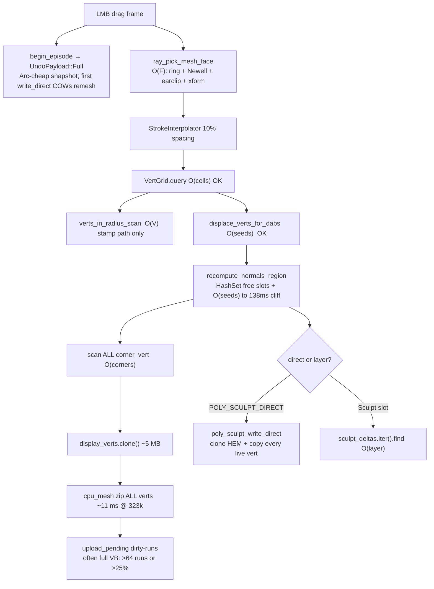
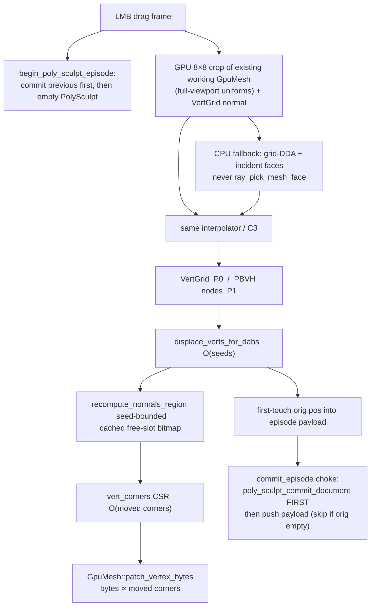

# ZBrush-Class Responsive PolySculpt — Architecture & Gated Implementation Plan

| Field | Value |
|---|---|
| **Title** | ZBrush-Class Responsive PolySculpt |
| **Author** | FourthLayer architecture (draft for owner review) |
| **Date** | 2026-08-15 |
| **Status** | Draft |
| **Repo** | `F:\PROJECT\FourthLAyerAi` |
| **Canonical path** | `docs/planning/sculpt/ZB_RESPONSIVE_SCULPT_PLAN.md` |
| **Supersedes** | v2 §C2 leftover **clone** (not display identity), §S0b O(V) oracle, §S4 kernel **order**. **Completes** S0c sparse undo (today `UndoPayload::Full`). |
| **Does not replace** | `SCULPT_FEEL_PLAN.md` + `SCULPT_FEEL_LOG.md` (feel). v2 **C1** (incl. last-slot test + open-stroke pin), **C3**, **S1** `FL4SCLP` bytes, **S2** rebase, **S3** support matrix. |
| **Not this program** | `docs/planning/render/MESH_MAP_BAKER_PLAN.md` (queued separately) |

---

## Overview

AZRA already deforms PolySculpt verts locally (`VertGrid` + `displace_verts_for_dabs`). The frame around that kernel is still **global**: every dragged frame CPU-scans every live face to pick, clones the full display vertex buffer, and in direct mode **deep-clones** the working `HalfEdgeMesh` then copies every live vert (`poly_sculpt_write_direct`). `begin_episode` snapshots `UndoPayload::Full` — `SceneGraph::clone` is **cheap Arc sharing** of `PolygonalBody.mesh`, but the first `Arc::make_mut` after that snapshot COWs the remesh, so **each Full stroke retains a unique remesh for the life of undo history**. That is why a 323k remesh feels heavy after Remesh even though the brush kernel is not the bottleneck.

This plan makes **stroke work O(brush), never O(mesh)** — the same locality thesis that makes Blender 4.3 sculpt and ZBrush feel instant. It is ordered so implementers cannot ship a GPU displace kernel before killing whole-mesh pick/upload/undo. **P0** is Blender-4.3-class responsiveness on current remesh densities. **P1** is a PBVH-class spatial tree. **P2** is subdivision/multires (ZBrush’s actual density trick). **P3** is optional GPU displace. We will **not** match ZBrush HD ~1B conceptual polys until P0+P1 are green at 500k–1M unique verts, and we will **not** build a pixol 2.5D renderer.

---

## 1. Product bar — three products, do not mix them

“As nicely as ZBrush” is three products AZRA currently conflates. Mixing them is how GPU kernels get written before the frame is local.

| # | Product | What it is | Status in AZRA | This plan |
|---|---|---|---|---|
| 1 | **Responsiveness** | Cursor-following stroke on a dense remesh. Frame cost ∝ brush, not mesh. | Owner’s live pain. Dense-mesh Surface Sculpt / PolySculpt after Remesh is heavy. | **Primary deliverable. P0–P1.** |
| 2 | **Feel** | Falloff, clay converge, spacing, pressure, lazy mouse, Grab field. | Separate program: `SCULPT_FEEL_PLAN.md` + `SCULPT_FEEL_LOG.md`. F1a + Clay-1 landed. F1b/F2/F3/Clay-2 still open. | **Do not restart.** Same producer (`input_sculpt`) + same kernel (`displace_verts_for_dabs`). Feel PRs stay on that track. |
| 3 | **Workflow depth** | Subdivision levels, HD-on-visible tiles, sculpt layers, DynaMesh-on-demand. | Partial: `PolyModifierType::Subdivide` exists; Remesh is a button; `PolyModifierType::Sculpt` layer exists. No SDiv stack, no HD tiles. | **Park** anything not required for responsiveness. P2 is the only slice we specify, and it is gated behind P0+P1. |

**Implementer rule:** if a PR does not cut a named O(mesh) cost on the stroke path (pick, corner scan, VB clone/upload, per-stamp `write_direct`, Full-episode remesh COW, O(V) oracle), it is not a P0 PR — even if it is a GPU kernel.

---

## 2. What Blender does / What ZBrush does / What AZRA does today

Blender is **not** ZBrush. Blender is a mesh sculptor that stays responsive via **locality + SoA + threads + partial GPU**. ZBrush’s “millions feel light” trick is **subdivision levels + visible-tile HD**, not a faster unique remesh. AZRA today is a mesh sculptor whose **kernel is local and whose frame is global**.

| Concern | Blender 4.3 sculpt (verified, code.blender.org 2024-11) | ZBrush (product architecture, not pixols) | AZRA today (re-read 2026-08-15) |
|---|---|---|---|
| **Pick / hit** | PBVH: test **nodes** vs radius / ray, then verts in those nodes. Same tree for brush query and raycast. | Pick from what you see. Stroke is local. | **O(faces) CPU every dragged frame.** `handle_poly_sculpt_input` → `ray_pick_mesh_face` (`poly_selection/mod.rs` 57–82). Modeling hover already refuses this mid-episode (`pick.rs` 255–267: 77–133 ms at 323k). Sculpt reintroduced it as the producer. GPU face-id buffer exists (`poly_select_gpu.rs`) but is gated **off** during episodes and is the **base cage**, not the remesh working mesh. |
| **Spatial query** | PBVH nodes. After 4.3: enter 5× faster (11 s → 1.9 s on 16M faces), brushes ~8×, memory −30%. | Local radius. | `VertGrid` uniform hash is the production query (`sculpt.rs` 55–80, 880). **Also** runs O(V) `verts_in_radius_scan` “to measure” on the stamp path (`sculpt.rs` 330–342, 423–441). |
| **Deform kernel** | SoA: one action for all verts in a node (SIMD-friendly). Multires SoA ≈ +32% brush. | Local radius verts. | **Already local.** `displace_verts_for_dabs` (`voxel_surface_sculpt.rs` 716) only runs on packed radius verts. Kernel is **not** the bottleneck. |
| **Display / GPU upload** | Node-local GPU chunks. After 4.3: reupload **only changed attributes** (1 dirty bit per node). Indexed drawing (verts per face corner). | Partial draw of touched region. | `poly_sculpt_flush_display` clones **all** `display_verts` then `update_chunk_verts_in_place` (`sculpt.rs` 647–669; `mesh_cache.rs` 744–776: ~5 MB clone + ~11 ms write at 323k). `write_display_corners` / `apply_dabs` scan **all** `corner_vert` to find moved ids (`sculpt.rs` 103–110, 942–948). `upload_pending` *can* dirty-run (`mesh_gpu.rs` 228–277) but is defeated by the full clone + O(V) cpu_mesh zip (`mesh_cache.rs` 797–810) + run explosion (>64 runs or >25% dirty → full VB write). |
| **Document write** | Working PBVH nodes are truth mid-stroke; mesh write is not per-dab. | Deform radius; commit is not a whole-mesh clone per dab. | **Draw / Smooth:** `poly_sculpt_write_direct` **deep-clones** `w.mesh` and copies every live vert every stamp (`sculpt.rs` 790–811, from stamp 486 and apply_dabs 982). **Grab does not write the document at all** (`poly_grab_update` 1059–1092: working + display only). Pointer-up only `commit_episode()` (`input_sculpt/stroke.rs` 192–203) — a Grab stroke is display-only today and snaps back on save/resync. |
| **Layer / deltas** | Shape keys / sculpt layers are a later feature; stroke undo is node-local. | Layers exist; not the frame cost. | Layer mode skips the write but `sculpt_deltas.iter().find` per moved vert (`sculpt.rs` 475–478, 970–974) → quadratic as the layer grows. Store is `Vec<(u32, Vec3)>` (`node.rs` 736). |
| **Normals** | Node-local / SoA. | Local. | `recompute_normals_region` (`normals.rs` 652+): **4.3 ms / 20k seeds, 138 ms / 161k seeds** on a 323k mesh. Builds `HashSet`s of free slots **every call** (664–666). Already falls through to full `recompute_normals` at ≥50% verts (679–681). Large brush = the 138 ms case. |
| **Undo** | Old: linear-search + lock = **60% of brush time**. New: `Map` keyed by PBVH node. Per-node storage 4 KB → 400 B. Whole-scene clone is the anti-pattern they killed. | Compact local undo. | `begin_episode("PolySculpt stroke")` (`sculpt.rs` 1120) → `snapshot_undo` → `UndoPayload::Full` (`undo.rs` 707–717, 977–980). `SceneGraph::clone` copies the node map and **increments Arcs** (`scene_graph/mod.rs` 58–68); `PolygonalBody.mesh` is `Arc<HalfEdgeMesh>` (`payload.rs` 138–140) — **not** a deep remesh copy at snapshot. The remesh becomes unique when `write_direct` / `Arc::make_mut` COWs it; history then holds **one remesh per Full stroke**. Completing S0c (sparse snapshot) is this plan’s P0-E. Voxel Surface already first-touches (`sculpt_state.rs` 141–147) on a **parallel** stack — do not copy that stack. |
| **Topology / density** | Multires modifier: sculpt a subdivision *level* (SDiv analog). Voxel remesh is a **button**, not the stroke. Dyntopo remeshes during the stroke and **is** laggy; users prefer remesh+multires. | Block-in at 100–500k, project to millions via **subdivision levels**. HD Geometry subdivides further only on **on-screen / in-memory tiles** (up to ~1B conceptual, system holds visible tiles). DynaMesh is a discrete remesh, used sparingly. Pixols are **2.5D document mode, not 3D sculpt**. | Remesh is a modifier/button (`PolyModifierType::Remesh`, default res **32**). Stroke never remeshes (correct). Direct enter bakes remesh into the body and disables Remesh/Smooth (`sculpt.rs` 543–548, 815–824). `PolyModifierType::Subdivide` exists (CC) but is not a live SDiv stack. No HD tiles. **Do not plan a pixol renderer** (`VIEWPORT_MODEL.md` / Display Invariant). |
| **Feel / producer** | One sculpt system; falloff/spacing/pressure in the stroke loop. | Local stroke + tablet. | C3 landed: `input_sculpt/stroke.rs` 170–204 routes PolySculpt through the same interpolator. Feel work stays in `SCULPT_FEEL_*`. `ChannelMask::DISPLACE` exists unused (`brush/mod.rs` 128, 457–460). `StampPlan` is voxel-local. |
| **Voxel room (analog)** | N/A (Blender sculpt is mesh). | 3D-Coat Voxel is the closer analog, not ZBrush HD. | Density + Surface Nets; atlas GPU stamps cheap at ≥256 (`SPARSE_RES_THRESHOLD`). Walls: Move bake, chunk remesh drain (`mesh_ms`), save/leave rebuild. Surface *mode* on voxel is CPU displace + chunk upload — closer to this plan. |

**Honest ceiling:** P0 makes AZRA feel like **Blender 4.3 on a remesh mesh** (“the brush keeps up with the cursor”). P2 is how both ZBrush *and* Blender Multires stay responsive at “millions.” We will not match ZBrush HD 1B until that stack exists, and not before P0+P1 are green at 500k–1M unique verts.

---

## 3. Background & Motivation

### 3.1 Why this change is needed

The owner’s live pain is **dense-mesh Surface Sculpt / PolySculpt after Remesh**. A 323k-tri remesh body is a normal sculpt density, not an extreme. Modeling already paid 77–133 ms for the same CPU face walk and **deleted it from hover mid-gesture**. Sculpt put it back as the hit producer. Combined with a full VB clone, a per-stamp deep `write_direct`, and a Full episode that COWs a remesh into undo history, the stroke frame is O(mesh) even when 20k verts move.

### 3.2 What is already landed (do not rebuild)

`SCULPT_LAYER_PLAN.md` v2 S0–S3 are in-tree. This plan **does not fork a third sculpt stack**.

| v2 contract | Landed where | Keep / supersede |
|---|---|---|
| **C1** last-slot never a full prefix hit | `mesh_sync.rs` 764–790 (`poly_sculpt_eval_working`; `skip_sculpt_prefix`). Test `polysculpt_slot_is_never_a_prefix_hit` (`mesh_sync.rs` 6227). | **Keep**, including the last-slot test. Mid-stroke, the match key is the **working mesh**, not `sculpt_delta_gen` (open-stroke pin, §7.4). Do **not** treat “C1 unchanged” as “keep bumping `gen` every dab.” |
| **C2** in-place display | `update_chunk_verts_in_place` + `display_verts` patch. | **Supersede the leftover clone** only. Keep `mesh_cache_id` identity / last-slot eval — that is C1, not C2. |
| **C3** same producer + kernel | `input_sculpt/stroke.rs` 170–204 → `handle_poly_sculpt_input` → `displace_verts_for_dabs`. | **Keep.** Feel PRs continue here. |
| **S0b** working mesh + `VertGrid` | `PolySculptWorking` (`sculpt.rs` 131–181). | **Keep the working mesh.** Augment `VertGrid` in P1; kill the O(V) oracle now. |
| **S0c** undo episode per stroke, sparse snapshot | Landed as `begin_episode` → `UndoPayload::Full` (`sculpt.rs` 1120). | **Complete** (P0-E). Not a display leftover. |
| **S1** `FL4SCLP` after `FL4PBEND` | `project/io.rs` 233–237. Round-trip tests in `project/tests.rs`. | **Keep. Do not widen.** Do **not** add positional fields to `PolyModifier` for HashMap/CSR/PBVH — those live on `PolySculptWorking` (runtime). |
| **S2** rebase via `project_points_to_mesh_filtered` | `poly_sculpt_eval_working` rebase + orphan toast (`sculpt.rs` 366–369). | **Keep.** Suppressed while a stroke is open (§7.4 pin). |
| **S3** brush breadth | `surface_brush_supported` + poly Smooth 1-ring (`sculpt.rs` 1226). Grab is anchored (`poly_grab_begin` / `poly_grab_update`) but **does not persist** today. | **Keep** the support matrix. P0-D makes Grab a first-class document consumer. |
| **S4** parked GPU kernel + region-raster | Unused `ChannelMask::DISPLACE`. | **This plan owns the order.** GPU kernel is P3, after P0–P1. |

`PolyModifierType` last variant is **`Sculpt`** (`node.rs` 317–378), after `Bend`. Exhaustive sites already include it (`label()` 1032, `apply_one_poly_modifier` 3798, `all_poly_modifier_types` 4092, Add-Modifier row `properties_poly.rs` 675). **Do not append another sculpt variant.**

### 3.3 Pain points with numbers (measured in-tree, not folklore)

Do **not** budget from the old v1 “~19 ms display” figure (`SCULPT_LAYER_PLAN.md` §0: that was a 4-vert drag split). Use these comments and re-measure in the P0 harness:

| Cost | Where | Measured note in tree |
|---|---|---|
| CPU face pick | `poly_selection/mod.rs` 57–82; hover refused at `pick.rs` 255–267 | 77–133 ms / frame at 323k tris (hover). Sculpt pays this **every dragged frame**. |
| Select-buffer settle walk | `poly_select_gpu.rs` 244–261, 314–318 | `[SLOWPOLL] polypick=44` at 323k; `content_signature` ~6 ms at 160k faces. Gated off during episodes — **cannot** be the live sculpt pick without a new path. |
| Full `display_verts` clone + in-place write | `sculpt.rs` 647–649; `mesh_cache.rs` 744–776 | ~5 MB clone + ~11 ms write at 323k. |
| Corner scan | `sculpt.rs` 103–110, 942–948 | O(corners) ≈ 3× faces per stamp. |
| Direct write | `sculpt.rs` 790–811 | Clone working mesh + copy every live vert, every stamp. |
| Region normals | `normals.rs` 669–673 | 4.3 ms / 20k seeds; **138 ms / 161k seeds** on 323k. Superlinear. |
| Full-episode undo | `undo.rs` 707–717 | Snapshot is Arc-cheap. First `write_direct` `make_mut` COWs the remesh; history retains one remesh per Full stroke. |
| Remesh eval (lockout, not per-stamp) | `SCULPT_LAYER_PLAN.md` §0 | ≈191 ms/eval on closed solids — the cost C1 avoids re-paying. |
| Kernel | `voxel_surface_sculpt.rs` 716 | Radius verts only. Not the frame. |

---

## 4. Goals & Non-Goals

### Goals

1. **Stroke frame is O(brush)** on the production path: pick, query, deform, normals, display patch, GPU upload, undo record.
2. **P0 targets** (split; do not stuff pick+normals into an 8 ms bag — see K15 / §19):
   - **Apply+upload** (query + kernel + CSR + `patch_chunk_verts` + first-touch), **excluding** `normals_ms` and `pick_ms`: p95 bar is **set by PR-0 measurement**, not invented here. Aspirational starting number if PR-0 comes in under it: 323k / &lt;20k seeds **&lt; 8 ms**; 1M same seeds **&lt; 12 ms**.
   - **`pick_ms`:** O(1) / non-scaling (G1). Not a subset of the 8 ms apply bar.
   - **`normals_ms`:** report `region` vs `full`. 20k-seed default is a **measurement**, not a 4.3 ms promise. G7 must not fail solely on 4.3 → 5–6 ms after the bitmap cache.
   - Upload bytes **proportional to moved corners**, not mesh (assert in harness).
   - Undo stroke start: **`UndoPayload::PolySculpt`**, no `scene_graph_snapshot` (assert payload size ≪ mesh bytes).
3. Owner A/B: same remesh body vs Blender sculpt at equivalent density — “the brush keeps up with the cursor.” Composite **16 ms overlays-off** is a **manual** A/B, not a CI tripwire until PR-0 numbers exist.
4. One stack: extend `poly/sculpt.rs` + `mesh_cache` + episode undo. No third sculpt engine.
5. Every gate: headless verify + negative test (`AZRA_*` harness style). Do **not** hardcode today’s test counts.

### Non-Goals

- **Feel knobs** (falloff presets, Clay-2 area plane, spacing 10%, pressure ramps). `SCULPT_FEEL_PLAN.md`.
- **Mesh-map baker.** `MESH_MAP_BAKER_PLAN.md`.
- **Pixol / 2.5D** renderer. Rejected (Alternative D). Violates `VIEWPORT_MODEL.md` / Display Invariant.
- **HD Geometry tiles / ~1B conceptual polys** until P0+P1 are green at 500k–1M unique verts.
- **Per-stroke DynaMesh / dyntopo.** Remesh stays a button. Dyntopo is the laggy path Blender users avoid.
- **Fused raster+raymarch.** Display Invariant (`CLAUDE.md`, `VIEWPORT_MODEL.md`).
- **New `PolyModifierType` variant** for this work. `Sculpt` is already last.
- **Widening `FL4SCLP` / `FL4PBEND` / any existing tail record.** New persistables get their own tail.
- **In-blob `#[serde(default)]` on positional bincode.**
- **New god-file.** New types go in `poly/sculpt_pick.rs`, `poly/sculpt_pbvh.rs`, `poly/sculpt_undo.rs` — not `main.rs`, not a 2k-line dump into `sculpt.rs`.
- **Voxel density-kernel rewrite.** Voxel Surface mode is an analog consumer of P0 upload/pick lessons, not the P0 subject.
- **Restarting C1/C3/S1/S2.**

---

## 5. Thesis

> **Stroke work must be O(brush), never O(mesh).**
>
> That is why Blender and ZBrush feel instant. AZRA already deforms locally; the *frame* is still global (pick, corner scan, VB clone/upload, document write, scene-graph undo).
>
> **Do not start with GPU mesh kernels or HD geometry.**

Order is load-bearing:

```
P0  Make the FRAME local     → Blender-class on current remesh densities
P1  PBVH-class spatial tree  → Blender's actual engine
P2  Subdivision / multires   → ZBrush's density trick
P3  GPU displace (optional)  → only after pick+upload+undo are local
```

---

## 6. Proposed Design

### 6.1 Current per-frame data flow (the anti-pattern)



### 6.2 Target local flow



### 6.3 Phase architecture

```mermaid
flowchart LR
  subgraph P0["P0 — frame is local"]
    A1[GPU/spatial pick]
    A2[Invert corner map]
    A3[Scatter GPU upload]
    A4[Commit-once write]
    A5[Sparse undo]
    A6[Kill O(V) oracle]
    A7[Seed-bound normals]
  end
  subgraph P1["P1 — PBVH"]
    B1[Face/vert BVH]
    B2[Node dirty bits]
    B3[SoA + rayon]
    B4[Undo keyed by node]
  end
  subgraph P2["P2 — multires"]
    C1[Sculpt mid SDiv]
    C2[Project to high]
    C3[Remesh stays a button]
  end
  subgraph P3["P3 — optional GPU"]
    D1["ChannelMask::DISPLACE"]
    D2[Node-vert compute]
  end
  P0 --> P1 --> P2
  P1 --> P3
```

---

## 7. P0 — Make the frame local

**Bar:** Blender-4.3-class responsiveness on current remesh densities (323k default-brush, then 1M same seed budget). No new spatial tree required. No GPU displace.

### 7.1 P0-A — Replace `ray_pick_mesh_face` on the stroke path

**Bug class:** hover already learned this (`pick.rs` 255–267). Sculpt reintroduced it (`sculpt.rs` 1138–1140).

**Ban list (implementing any of these is a failed PR-4, not a “first try”):**

1. Do **not** call `render_poly_select_buffer` / lift the episode gate / walk `ray_pick_mesh_face` on the stroke path.
2. Do **not** rebuild a `PolyPickVertex` (or HEM earclip) buffer every frame from `w.mesh` or the authored cage. That **is** the 44 ms `[SLOWPOLL] polypick` walk (`poly_select_gpu.rs` 314–318) moved to a new file — still O(F) on the CPU.
3. Do **not** call `pick_node_at` every dragged frame (full-scene color ID, click-only, ~1 ms, `raster_pick.rs` 37–46).
4. Do **not** share `picking_staging`. `copy_pixel` + a still-mapped staging is a device-loss crash (`raster_pick.rs` 47–55; `picking.rs` 715–721). `copy_pixel` copies the **color** pick texture (`Rgba8Uint`), **not** `Depth32Float` — there is no depth-readback helper today (`picking.rs` 611–635).
5. Do **not** consume `poly_pick.wgsl` / `PolyPickVertex { pos, id }` against the display `GpuMesh`. Display verts are `RasterVertex { pos, nrm, uv }` (`mesh_gpu.rs` 10–14) with **no face-id attribute**.
6. Do **not** shrink the projection to the 8×8 (`ensure_textures(8, 8)` + `from_orbit(..., aspect=1)` or a full-viewport `view_proj` dumped into an 8×8 thumbnail). That is the default wrong reading of “tiny RT.” Crop with `set_viewport` (§7.1 steps 2–4).

**Why those machines do not compose:**

| Existing path | Why it cannot be the stroke producer |
|---|---|
| `poly_select_gpu.rs` full-viewport ID image | Episode-gated (`poll_poly_select_buffer` 261). **Base cage** (291–292). 8 MB readback. `poly_pick_mesh_key` walks content+stack (~6 ms at 160k). |
| `raster_pick.rs` `pick_node_at` | Node id of the **whole scene**, click-only. Color, not depth. Shares `picking_staging`. |
| Live remesh solid | `GpuMesh` of `RasterVertex` + IB. No face-id. This **is** the pick source — draw it, do not rebuild it. |

**Production algorithm — `poly_sculpt_pick_hit` (`app/src/poly/sculpt_pick.rs`):**

1. **Draw the existing working-mesh `GpuMesh`.** Source = `mesh_cache_id` already holding the flushed display (`RasterVertex` VB + its IB + the **same instance transform** the G-buffer uses for that cid). Mid-stroke “VB is one flush behind” is acceptable **only if this pick draws that VB**. It is **not** acceptable if PR-4 rebuilds a pick mesh from `w.mesh`.
2. **Crop, do not shrink the projection.** Dedicated 8×8 color+depth target and **own staging** (never `picking_staging`; never an 8 MB select image). Build `CameraUniforms` for the **full viewport** aspect — the same `from_orbit` as the G-buffer / `cam_ray` (`camera.rs` 90–115: `perspective_rh` / `orthographic_rh`, depth `Less`, clear `1.0`, **not** reverse-Z). On the 8×8 pass, `set_viewport(4.0 - cursor_px, 4.0 - cursor_py, vp_w, vp_h)` (egui / AZRA y-down; tile centered on the cursor) so NDC matches the main view and only the 8×8 window is stored. Do **not** rebuild `proj` with `aspect = 1`. Do **not** render the full scene into 8×8 without that offset (`pick_node_at` is the opposite precedent: full-viewport RT then `copy_pixel` — we crop instead).
3. **Tile size = 8×8** (not 1×1). Remesh silhouettes punch 1 px holes. Sample the 8×8; use the texel **closest to the tile center (4,4) with a valid depth** (that is the cursor pixel; neighbors are the recovery ring). Miss the whole tile → no stamp (fail closed).
4. **Unproject the winning texel, not always the cursor.** Pack raster `frag_pos.z` / clip `z/w` (standard **0..1**, `Less`, **not** reverse-Z, **not** a second “hyperbolic” encoding that disagrees with `view_proj`). Convert tile `(tx, ty)` → screen `(cursor_px + (tx - 4), cursor_py + (ty - 4))`, then unproject with the **same convention as `mouse_to_ray` / `cam_ray`** (y-down). World → local via `world_transform(nid).inverse()`. Face id is **not** required for P0. Normal = nearest live vert via existing `VertGrid.query` in a 1–2 cell radius (`sculpt.rs` 1146–1153 — keep that, drop the face walk). Color-target pack **(a)** or a new 8×8 depth-tex helper **(b)** are both legal; `copy_pixel` is **not** that helper.
5. **Copy / staging:** own buffer, `bytes_per_row = 256` (`COPY_BYTES_PER_ROW_ALIGN` in `picking.rs` 13–14 — wgpu rejects an 8×`R32Float` row of 32 bytes), **8 rows**. Do not share `picking_staging`.
6. **Occlusion (accepted):** this pass draws **only** the active cid. Other objects do not occlude. Stated product edge, not a bug. A later pass may add id-0 occluder bodies; not P0.
7. **Optional later (not P0):** a topology-stable pick-id VB may be built **once on enter/rebase** (same lifetime as `vert_corners`) and scatter-updated with P0-C. Never from-scratch per dab.
8. **GPU device test is required for G1** (same class as `pool_consistency_gpu`). Not optional. A **center-only any-hit** test is **not** enough (a thumbnail RT still hits a centered cube).

**CPU fallback** (headless `gpu: None`, or GPU miss). Production is GPU; this path is **not** claimed to meet the apply+upload bar on fat cells (`grid_cell_for` is ~2% of AABB, clamped `[0.01, 1.0]`, `sculpt.rs` 192–208):

- 3D grid traversal of `VertGrid` cells along the ray (Amanatides & Woo voxel walk; step by `VertGrid.cell`).
- For verts in **crossed cells only**, walk incident faces via existing `HalfEdgeMesh::vertex_fan_into` (no CSR required — PR-4 does **not** depend on PR-2). Dedup face ids in the tile.
- Earclip those n-gons with the **same** `earclip_polygon` as `ray_pick_mesh_face` (`poly_selection/mod.rs` 73). Skip faces whose ring contains a hidden vert (pass the same `hidden` set; stroke today passes empty).
- Closest-t hit wins. **Abort after `K` face tests** (`K` start **4096**, measure) and return miss (fail closed). Do not fall back to a full `ray_pick_mesh_face`.
- **`ray_pick_mesh_face` is banned on the stroke path** (`handle_poly_sculpt_input`, `poly_grab_begin` first hit). Keep the function for one-shot modeling tools.

**Grab exception (already correct):** after `poly_grab_begin`, drag is a view-plane intersection (`sculpt.rs` 1175–1207). Do not re-pick the mesh mid-Grab. First hit still goes through `poly_sculpt_pick_hit`.

**Negative test:** same camera/ray on an 8k-face body vs a 323k remesh; GPU-path `pick_ms` ratio &lt; 2× (does not scale with `F`). CPU fallback must not visit more faces than incident-to-crossed-cells, and must abort at `K`. A test that calls `ray_pick_mesh_face` from the stroke function fails. **Device test (required):** GPU world hit vs `ray_pick_mesh_face` on a fixture with the cursor **not** at viewport center; points within a small epsilon (e.g. 1e-3 × body extent). A center-only “any hit” test is not enough.

### 7.2 P0-B — Invert the corner map (`vert → [corners]`)

Today `corner_vert: Vec<u32>` is corner→vert (`sculpt.rs` 139, 211–232). Every stamp builds a `HashMap` by scanning **all** corners (`write_display_corners` 103–110; duplicated in `apply_dabs` 942–948).

**Change** (build once in `raster_with_corner_map` / `from_prefix`):

```rust
/// CSR: corners of vert i are `vert_corners[vert_off[i] .. vert_off[i+1]]`.
pub vert_off: Vec<u32>,
pub vert_corners: Vec<u32>, // display-vert indices
pub vert_faces: Vec<u32>,   // incident live face ids (CPU pick fallback)
```

`write_display_corners(w, ids)` becomes O(moved corners). Delete the per-stamp `HashMap` + full scan.

**One writer, enforced:** `poly_sculpt_apply_dabs` already forks a second full `corner_vert` scan + local HashMap (`sculpt.rs` 942–961) instead of calling `write_display_corners`. PR-2 must delete that copy. Stamp, Grab (`poly_grab_update` 1086–1087), and apply_dabs all call **the same** helper. G2 negative: no second `for (ci, &vid) in w.corner_vert` anywhere in `sculpt.rs`.

`raster_with_corner_map` must stay aligned with `raster_data_ngon_with_normals` face order (already the contract at 211–212). CSR / `vert_faces` live on `PolySculptWorking` only — **no** positional fields on `PolyModifier`.

### 7.3 P0-C — Partial GPU upload (no `display_verts.clone()`)

**Today:** `poly_sculpt_flush_display` clones the entire `display_verts` (`sculpt.rs` 648–649) even though only a stamp’s corners changed. `update_chunk_verts_in_place` then zips **all** verts into `cpu_mesh` (rayon at ≥65536, `mesh_cache.rs` 797–810). `upload_pending` diffs the full arrays (`mesh_cache.rs` 426–458). `update_vertices_dirty_runs` (`mesh_gpu.rs` 228–277) already patches runs, but:

- it **scans all verts** to find diffs (O(mesh));
- **>64 runs or >25% dirty → full VB write**;
- n-gon / remesh corners of a local stamp are **scattered** → run explosion → full write anyway;
- the 5 MB clone + 11 ms zip happen *before* any of that.

**Change:**

1. Stop cloning. Keep `display_verts` as the CPU display SoA; patch in place via 7.2.
2. New mesh_cache API (do not overload `update_chunk_verts_in_place` to take a full vec):

```rust
impl MeshCache {
    /// Scatter-write known dirty display corners. Bytes ∝ patches.
    /// Coalesce indices into ≤64 byte-range writes via GpuMesh::patch_vertex_bytes.
    /// Updates only those slots in cpu_mesh. Does not clone the cage.
    pub fn patch_chunk_verts(
        &mut self,
        id: MeshCacheId,
        patches: &[(u32, [f32; 8])], // (corner_index, pos+nrm+…)
    ) -> bool;
}
```

3. If coalesced runs > 64, pack a compact staging buffer and write runs anyway — **do not** fall back to cloning the cage. Full VB write (via `update_vertices_only` on the **known** patched set gathered into a temp, never a full `display_verts` clone) is allowed only when `patches.len() * 4 > display_verts.len()` (25% rule from the known set, not a scan).
4. **`upload_pending` protocol (closes the voxel `surface_pool_synced` class):**
   - `upload_pending` is time-budgeted at **5.0 ms** (`UPLOAD_BUDGET_MS`, `mesh_cache.rs` 382). If `patch_chunk_verts` re-queues a full `imported_raster` corner array, the next drain may **re-diff and overwrite** the scatter (or stall 5 ms).
   - Therefore `patch_chunk_verts` **must**:
     1. patch `cpu_mesh` slots at the dirty indices only;
     2. `GpuMesh::patch_vertex_bytes` **now** (immediate `queue.write_buffer`);
     3. patch `imported_persistent` **in place** at those indices (it is the last-uploaded baseline, `mesh_cache.rs` 831–836);
     4. **not** insert/replace `imported_raster` for this cid;
     5. **not** set `full_replace_pending`;
     6. **not** go through `update_vertices_dirty_runs` on the sculpt path.
   - If `gpu_mesh` is `None`: cpu_mesh + persistent only (headless). Do not queue a raster entry.
5. Headless tests assert `display_verts` / `cpu_mesh` slots changed without a device.

**Negative test:** after a stamp, `imported_raster` is **absent or unchanged** for that cid and `upload_pending` is a **no-op** for it. A 20k-seed stamp on a 323k mesh uploads **bytes ≤ 20k × valence × 32 × slack** (valence from the inverted map; slack ~2×). Fail if uploaded bytes ≥ 50% of the VB.

### 7.4 P0-D — No per-stamp `poly_sculpt_write_direct`

**Today:** every `poly_sculpt_stamp` / `poly_sculpt_apply_dabs` in direct mode **deep-clones** the working HEM and copies every live vert into the authored `Arc<HalfEdgeMesh>` (`sculpt.rs` 485–487, 981–982, 790–811). That is a whole-mesh document write **per dab**. After a Full snapshot, the first `Arc::make_mut` COWs the remesh.

**Grab is display-only today** and must not stay that way. `poly_grab_update` (1059–1092) writes working + display only — no `write_direct`, no `sculpt_deltas`. Pointer-up only `commit_episode()` (`input_sculpt/stroke.rs` 192–203). Save, Full restore + resync, or `poly_sync_mesh_cache` **drops the Grab**. Grab is a **first-class P0-D consumer**.

**C1 last-slot never-full-hit stays. The match key during an open stroke is the working mesh, not `sculpt_delta_gen`.** Do not tell implementers “C1 unchanged” and then stop bumping `gen` — that combination wipes the stroke.

Today C1 stays coherent because **every dab** bumps both sides (`w.gen` and `m.sculpt_delta_gen`, `sculpt.rs` 464–481 / 962–977). `poly_sculpt_eval_working` (168–170, 350–361) on a miss **rebuilds from prefix + `m.sculpt_deltas`**. After P0-D’s first dab, `w.gen != m.sculpt_delta_gen`. The next `apply_poly_modifiers_cached` walk (`mesh_sync.rs` 767–772) misses, reclones the remesh prefix, re-applies **pre-stroke** deltas, and replaces `PolySculptWorking`. That walk is not rare:

- `poly_sculpt_flush_display` falls back to `DirtyFlags::MESH` when in-place upload fails (`sculpt.rs` 675–678).
- `commit_episode` always calls `poly_remesh_reconcile_diverged` (`undo.rs` 1021–1023).
- `poly_force_display_resync` → `poly_prefix_cache_remove` → **`poly_sculpt_drop(nid)`** (`mesh_sync.rs` 411–428). Prefix LRU eviction can drop the working mesh *today*.

**Open-stroke pin (part of C1, not a display leftover):**

While `sculpt.poly_edit` is `Some` **and** (`stroke_active` **or** a pending `UndoPayload::PolySculpt` episode exists):

1. `poly_sculpt_eval_working` **always** returns the live working mesh. Ignore `gen` mismatch. Never rebase. Never `from_prefix` from stale `sculpt_deltas`.
2. `poly_sync_mesh_cache` / `poly_force_display_resync` / prefix evict **must not** `poly_sculpt_drop` the active edit target. Display rebuild sources `display_verts` / working mesh, never authored / pre-stroke deltas.
3. After the document commit (§7.4 choke), bump `w.gen` and `m.sculpt_delta_gen` **together** so the next idle walk matches again.

**Negative:** N dabs, force a modifier-stack walk (and a prefix evict of *other* bodies), working positions still equal the post-dab set, remesh eval count still constant. `polysculpt_slot_is_never_a_prefix_hit` still passes **during an open stroke**.

**Contract:**

| Moment | Direct (`POLY_SCULPT_DIRECT`) | Layer (`PolyModifierType::Sculpt`) |
|---|---|---|
| Enter | Keep **one** `poly_sculpt_write_direct` to bake Remesh/Smooth into the body and disable those mods (`sculpt.rs` 543–548). Enter-cost, not frame-cost. | Working mesh from prefix; deltas sidecar. Last-slot never stored. |
| Each dab (Draw / Smooth / **Grab**) | Working mesh + display only. **No** graph mesh write. **No** `get_mut` on the body mesh. | First-touch / HashMap accumulate on **working state**, not `sculpt_deltas.iter().find` on the modifier every dab. |
| Release / any episode close | **One** `poly_sculpt_commit_document`: copy **only the stroke-touched set** (current working positions) into the authored mesh. Same-topology only; remesh-replace + disable-mods stays enter-only. | Flush `HashMap<u32, Vec3>` → `m.sculpt_deltas` (`delta = current - prefix_pos`) + bump `sculpt_delta_gen` once. |
| Undo | Swap positions on working + authored (see §7.5). | Working pos = orig; `sculpt_deltas[id] = orig - prefix_pos` — **never write positions into the delta channel**. |

**Grab:** `poly_grab_begin` seeds the episode touched/orig set from `PolyGrabAnchor`. Release `poly_sculpt_commit_document` copies **those** ids. G4 verify: Grab stroke, pointer-up, authored (or `sculpt_deltas`) differs on the frozen set; leave-edit / save / resync does **not** snap back.

**Document-commit choke point is `commit_episode`, not `stroke.rs`.** Closers that only call `commit_episode()` today:

- `input_sculpt/stroke.rs` 192–203 (LMB-up)
- `auto_commit_episodes` (`undo.rs` 1061–1094) on pointer-up with **no** sculpt hook
- `undo()` (`undo.rs` 12–14) — commits first, then pops
- `begin_episode` of a later tool (`undo.rs` 977–978 auto-commits the previous)

If the write is only hooked in `stroke.rs`, a frame that closes via auto-commit / Ctrl+Z / tool switch leaves RAM-only dabs; the next resync loads pre-stroke authored / deltas. **And** `commit_episode` then runs `poly_remesh_reconcile_diverged` **before** any write if the hook is elsewhere.

**Rule:** at the top of `commit_episode`, if `sculpt.poly_edit` is `Some` and the pending payload is `PolySculpt`, call `poly_sculpt_commit_document` **first**, then push the payload, then remesh reconcile. `leave_edit` calls `commit_episode` (already does if `stroke_active`). `stroke.rs` stays a caller of `commit_episode` **only**. G4 asserts the write happens for auto-commit and mid-stroke Ctrl+Z, not only LMB-up.

**Save / export mid-stroke:** after P0-D the authored mesh is pre-stroke until commit. Same as any DCC (Blender does not flush sculpt to the ID datablock every dab). Stated: save mid-stroke writes the last **committed** document. Crash mid-stroke loses the open dabs (RAM-only). Not P0 to add a periodic flush.

**Layer HashMap:** runtime only, on `PolySculptWorking`. Persist format stays `Vec<(u32, Vec3)>` on `PolyModifier.sculpt_deltas` (`node.rs` 736, `#[serde(skip)]` + `FL4SCLP`). Convert Vec→HashMap on enter/eval; HashMap→sorted Vec on commit/save. **Do not change `FL4SCLP`.** **Do not add positional fields to `PolyModifier`.**

**Open product question (does not block P0-D):** whether *default* Surface Sculpt stays “direct write on release” or becomes a Sculpt layer. Mechanically both share the same mid-stroke path; only the commit target differs. See §17.

### 7.5 P0-E — Sparse undo (completes S0c; no Full remesh retained per stroke)

**Today:** `handle_poly_sculpt_input` calls `begin_episode("PolySculpt stroke")` (`sculpt.rs` 1119–1120) → `snapshot_undo` (`undo.rs` 977–980, 707–717) → `UndoPayload::Full`. The snapshot itself is Arc-cheap (`SceneGraph::clone` increments `Arc<HalfEdgeMesh>`). The **retained remesh** appears when `write_direct` / `make_mut` COWs against the undo Arc — one unique remesh per Full stroke for the life of history. P0-D+E kill the per-stamp deep clone **and** the per-stroke retained remesh.

S0c already required “Undo episode per stroke (**sparse snapshot**)” (`SCULPT_LAYER_PLAN.md` §3 S0c). What landed is Full. P0-E **completes S0c**.

Voxel Surface already first-touches (`surface_stroke_snap` → `UndoKind::Surface`, `sculpt_state.rs` 141–147) on a **parallel** stack. PolySculpt must not grow a second stack (CLAUDE.md / FEATURE_RULES). Add a variant on the **existing** episode stack. Keep the name **`PolySculpt`** — do **not** reuse `UndoPayload::Poly` (Euler `OpDelta`).

```rust
// app_types/src/types_transform.rs — session-only, enum is not Serialize
pub enum UndoPayload {
    Full { … },
    Delta { … },
    Poly { … },      // Euler OpDelta — do not reuse
    Selection { … },
    /// Sparse PolySculpt stroke. Orig positions of verts first-touched this episode.
    /// `slot == None` ⇒ direct (authored mesh). `Some(i)` ⇒ Sculpt modifier slot.
    PolySculpt {
        nid: core_math::scene_graph::NodeId,
        slot: Option<usize>,
        orig: Vec<(u32, [f32; 3])>, // VertexId.0, pre-stroke local POSITION (not a delta)
    },
}
```

**Apply semantics (swap, not “rewrite keys”):**

| Mode | Undo | Redo |
|---|---|---|
| Direct | For each `(id, orig)`: swap working pos ↔ orig; copy the restored pos onto the **authored** mesh at `id`. | Swap again (redo entry holds the post-stroke positions collected at apply). |
| Layer | Working pos = orig. Then `sculpt_deltas[id] = orig - prefix_pos` (prefix = `PolySculptWorking.prefix` verts). **Never write `orig` into `sculpt_deltas` — that channel is delta-from-prefix** (`node.rs` 733–736). | Working pos = post; `sculpt_deltas[id] = post - prefix_pos`. |

**Dirty flags:** if `mesh_cache_id` is still the same cid **and** `poly_sculpt_working` still holds this nid, in-place patch via 7.2 (no `SCENE`). **Else `DirtyFlags::MESH`.** Full undo used to mark only `RENDER` and the restored cid never rebound (`undo.rs` 424–431 — owner “surface stuck after Ctrl+Z”). Full already does `poly_sculpt_working.clear()` (394–396). Reopening RENDER-only is that trap.

**`undo()` commits first** (`undo.rs` 12–14). Mid-stroke Ctrl+Z `commit_episode()`s the pending payload, then pops it. Because §7.4 hooks the document write **inside** `commit_episode`, the sidecar/authored mesh already has the stroke when the new apply arm runs. G5 covers this path, not only LMB-up.

**Cancel:** `cancel_episode` (`undo.rs` 1041–1052) **just drops** `pending_episode` — it does not restore. Gizmo cancel restores from **tool orig**, then drops (`gizmo_drag.rs` 759–784). PolySculpt cancel must restore orig **then** drop, in `sculpt_undo.rs` (`poly_sculpt_cancel_episode`), **not** by changing the current `cancel_episode` for every tool.

**Empty `orig`:** a dab-less stroke (miss every frame) must **not** push a junk `PolySculpt { orig: [] }` entry. `commit_episode` drops an empty PolySculpt payload without pushing.

**Exhaustive `UndoPayload` matches to update** (no `_` arm on apply/swap — compile-fail is real; `if let Full` sites will treat `PolySculpt` as empty, which is correct if documented):

| Site | Kind |
|---|---|
| `undo.rs` apply/swap (368–562) | **Must** add a `PolySculpt` arm (no `_`). |
| `types_transform.rs` `scene_graph_snapshot` / `scene_graph_snapshot_ref` (121–135) | Return `None` (like `Poly` / `Selection`). |
| `undo.rs` `restore_undo_no_redo` (1111) | `if let Full` — PolySculpt is not a graph restore; leave as-is. |
| `array_dup.rs` 695, `transform_modal.rs` 273 | `if let Full` “is this a real snapshot?” — PolySculpt is empty here; correct. |

Adding a variant is **not** a save-format change (undo is session-only).

**Lifecycle:**

1. `begin_poly_sculpt_episode` **constructor side effects** (mirror `begin_episode` at `undo.rs` 977–991, minus the Full snapshot):
   1. **`commit_episode()` first** — runs the §7.4 document choke on any previous PolySculpt/gizmo episode. **Do not** overwrite `pending_episode` without this; that drops an open stroke without a write.
   2. Install `pending_episode = PolySculpt { nid, slot, orig: [] }`. **Do not** call `snapshot_undo`.
   3. Copy bake-suppress: if `dc_mesh_route(false) == CpuChunkedOracle`, set `suppress_bake_dispatch = true` (same flag as `begin_episode`).
   Still an episode (`auto_commit_episodes` / FEATURE_RULES).
2. First time a vert moves this stroke, push `(id, old_pos)`. **Grab:** `poly_grab_begin` copies `PolyGrabAnchor.orig` into the payload immediately (frozen set).
3. `commit_episode` runs `poly_sculpt_commit_document` first (§7.4), then pushes if `orig` is non-empty.
4. `poly_sculpt_cancel_episode` restores orig on working + display (+ authored/layer if a partial commit somehow ran — it must not), then `cancel_episode`.

**Negative test:** start a stroke on a 323k remesh; assert `pending_episode` is `PolySculpt` and `payload_bytes ≪ mesh_bytes` (e.g. after a 20k-seed stroke `< 20k * 16 * 2`). Fail if `scene_graph_snapshot` is `Some`. Layer undo: `sculpt_deltas[id] + prefix_pos` equals the restored working pos. Dab-less stroke: undo stack length unchanged. `poly_sculpt_params_round_trip` / unused `FL4SCLP` fixture still byte-identical.

**Memory:** 20k first-touch verts × 16 B ≈ 320 KB vs one COWed remesh (tens of MB) per Full stroke. Cap `orig` at the seed cliff (7.7); if the stroke would exceed the cap, fall back to a **single-body** `Arc<HalfEdgeMesh>` of the working mesh only — still not a Full `scene_graph` snapshot.

### 7.6 P0-F — Kill the always-on O(V) oracle

`poly_sculpt_stamp` (`sculpt.rs` 423–441) always runs `verts_in_radius_scan` and `debug_assert_eq!`s it against the grid. Production query is already the grid (428).

- Gate the scan behind `AZRA_SCULPT_ORACLE=1` or `cfg(debug_assertions)` **and** a size cap (e.g. skip if `vertex_count > 50_000`).
- Never on the `poly_sculpt_apply_dabs` / Grab hot path (already clean).
- Keep `verts_in_radius_scan` as a test helper.

### 7.7 P0-G — Bound the normals cliff

`recompute_normals_region` is correct and stays. Two structural costs:

1. **Free-slot `HashSet`s rebuilt every call** (`normals.rs` 664–666). Move onto `RegionScratch` (already thread-local, 685–693) or a bitmap on `HalfEdgeMesh` invalidated only on topology change. Topology is stable for the whole sculpt stroke.
2. **Seed cliff** (669–681): 4.3 ms @ 20k, 138 ms @ 161k, already full-pass at ≥50% verts.

**Policy (honest, no 4.3 ms pretence):**

| Seeds `S` vs live verts `V` | Action |
|---|---|
| `S * 2 >= V` | Full `recompute_normals` (already). HUD: `normals=full`. |
| `S > NORMAL_SEED_SOFT` (start **20_000**, the 4.3 ms case) | HUD warn. Do **not** silently drop seeds. |
| `S > NORMAL_SEED_CLIFF` (start **80_000**; re-measure) | **P0 default = full `recompute_normals` + HUD** (honest hitch). Radius-cap is an **optional pref**, not a P0 reopen (K8). |
| else | Region pass as today, with cached free-slot bitmap. |

Do not subsample seeds (wrong normals). Do not claim 4.3 ms past the soft cap. The 8 ms apply+upload bar **does not include** `normals_ms` (K15).

### 7.8 P0 file map (no god-file)

| File | Role |
|---|---|
| `app/src/poly/sculpt.rs` | Keep working mesh, grid, apply, Grab. Call pick/undo/flush helpers. Delete per-stamp write + oracle. |
| `app/src/poly/sculpt_pick.rs` | **New.** Dedicated 8×8 working-`GpuMesh` pick (**viewport crop**, full-viewport uniforms) + grid-DDA fallback. Own staging, `bytes_per_row=256`. |
| `app/src/poly/sculpt_undo.rs` | **New.** `begin_poly_sculpt_episode`, first-touch, apply/restore, `poly_sculpt_cancel_episode`. |
| `render/src/mesh_cache.rs` + `mesh_gpu.rs` | `patch_chunk_verts`: immediate `patch_vertex_bytes`, no `imported_raster`. |
| `core_math/src/half_edge/normals.rs` | Free-slot scratch; no behavior change below the cliff. |
| `app_types/src/types_transform.rs` + `app/src/undo.rs` | `UndoPayload::PolySculpt`. **`commit_episode` is the document-commit choke point.** |
| `app/src/input_sculpt/stroke.rs` | Caller of `commit_episode` only (no direct document write). |
| `app/src/sculpt_state.rs` | `PolySculptProfile` fields (see §14). |
| `app/src/poly/mesh_sync.rs` | Open-stroke pin: no `poly_sculpt_drop` of the active edit target; eval returns live working mesh. |

---

## 8. P1 — PBVH-class spatial locality

**When:** P0 gates green at 323k default-brush. P1 is what makes large brushes and 1M+ unique verts stay O(brush) without a seed cap.

### 8.1 What to build

A **face/vert bounding-volume tree over the working mesh** — Blender’s PBVH, not the SDF prim SAH in `core_math/src/bvh.rs` (wrong domain: GPU SDF traversal, LEAF_BIT encoding). New module: `app/src/poly/sculpt_pbvh.rs` (or `core_math/src/half_edge/pbvh.rs` if we need it headless without `app`).

**Do not delete `VertGrid` on day one.** Grid stays the P0 query. PBVH replaces it when the tree’s query is measured ≤ grid at the same seed counts **and** also serves pick + draw batches.

Leaf budget (starting point, measure): **~250–2000 verts / node**, analogous to voxel 16³ chunks and Blender PBVH leaves. Build on enter / remesh rebase (`from_prefix`). Incremental **refit** of dirty node AABBs after a stamp (moved verts); rebuild only if a vert leaves its leaf AABB by > ε (rare for clay; common for huge Grab — rebuild those nodes).

### 8.2 Same structure, four consumers

| Consumer | Use |
|---|---|
| Query | Nodes vs brush sphere, then verts in those nodes. Replaces `VertGrid.query`. |
| CPU pick fallback | Ray vs nodes, then incident faces. Replaces grid-DDA if faster. |
| GPU draw / upload | One VB range (or one chunk) per node. Dirty bit per node → reupload **only dirty nodes / only dirty attributes** (Blender 4.3: 1 bit, not every attribute). |
| Undo | `HashMap<NodeKey, node_orig>` — Blender’s 60% lesson. P0’s first-touch map becomes per-node in P1. |

### 8.3 SoA + rayon

Today `displace_verts_for_dabs` is already SoA over a packed `[f32; 8]` of **radius** verts. P1 packs **per node** (better cache, enables `par_iter` over nodes). Rayon is already used in `mesh_cache` at ≥65536 (`mesh_cache.rs` 673, 797). Threshold: parallelize when **dirty nodes ≥ 4** and **dirty verts ≥ 4096** (measure; do not copy the 65536 whole-mesh gate).

One action per node (positions, then normals), not “everything for one vertex” (the cache-hostile pattern Blender deleted).

### 8.4 Node-dirty GPU

Extend `patch_chunk_verts` (or replace the single-cid poly solid with N node ranges into the **same** VB — Display Invariant: still one triangle raster, one depth). Dirty node → `GpuMesh::patch_vertex_bytes` for that range. Indexed drawing already (corners, not unique verts) — keep it.

Do **not** split into a second render technique. Object Mode stays one G-buffer (`VIEWPORT_MODEL.md`).

---

## 9. P2 — Subdivision / multires (ZBrush’s density trick)

**When:** P0+P1 green at **500k–1M unique verts**. Not before.

This is how ZBrush *and* Blender Multires stay responsive at “millions.” You block-in at 100–500k, project to a high level, sculpt the **current** level.

### 9.1 What to use, what not to invent

- **Use** existing `PolyModifierType::Subdivide` (Catmull-Clark, `node.rs` 318) as the level generator, **or** a new append-only `Multires` variant **after** `Sculpt` with its own tail (not a widened `FL4SCLP`). Decision at P2 kickoff; default lean: **Multires as its own modifier above/below Sculpt**, not a silent mode inside Subdivide.
- **Sculpt the mid level** (working mesh = that level’s unique verts). P0/P1 locality applies to that mesh, which is why P2 is cheap if P0+P1 hold.
- **Project to high** on level-up / render / bake using existing `project_points_to_mesh` / `_filtered` (`io_bridge/mesh_to_sdf.rs` — S2 already reuses this). No third projector.
- **DynaMesh = existing Remesh modifier / another Remesh after Sculpt** (already parked in `SCULPT_LAYER_PLAN` S4). Manual button, never per-stroke.
- **Do not invent HD tiles** (on-screen only, ~1B conceptual). That is a later product, after unique 1M is comfortable.

### 9.2 Honest product sentence

> We will not match ZBrush HD 1B until P2 (and a later HD-tile program). P0 is Blender-4.3-class on remesh meshes. Shipping P2 before P0 is how you get a beautiful SDiv UI on a 7 fps brush.

---

## 10. P3 — GPU displace (optional, after P0–P1)

**When:** pick + upload + undo are local (P0 green, P1 tree exists). **Not before.**

- Consume unused `ChannelMask::DISPLACE` (`brush/mod.rs` 128) via `apply_stamp_plan_mesh` or a compute shader that displaces **node verts**.
- Feel parity red line: GPU result must match `displace_verts_for_dabs` within the existing voxel CPU/GPU epsilon discipline (`SCULPT_FEEL_PLAN.md` §1). Surface mappings stay the oracle (Clay plane, Grab field, Smooth 1-ring — poly Smooth is **not** the voxel spatial hash, `sculpt.rs` 905–909).
- This is `SCULPT_LAYER_PLAN` S4 “real second StampPlan consumer.” Only if/when voxel Surface mode and PolySculpt should converge on one engine.
- Display Invariant: compute writes positions into the existing VB; raster is still the one G-buffer.

---

## 11. API / Interface Changes

### 11.1 New / changed Rust APIs (names must not collide)

```rust
// app/src/poly/sculpt_pick.rs
pub(crate) struct SculptHit {
    pub local: glam::Vec3,
    pub world: glam::Vec3,
    pub normal: glam::Vec3,
    /// Unused in P0 (VertGrid supplies the normal). Do not rebuild a face-id VB to fill this.
    pub face: Option<u32>,
    pub pick_ms: f32,
}

impl AzraApp {
    pub(crate) fn poly_sculpt_pick_hit(
        &mut self,
        nid: NodeId,
        ray_o: glam::Vec3,
        ray_d: glam::Vec3,
        screen: Option<egui::Pos2>,
    ) -> Option<SculptHit>;
}

// render/src/mesh_cache.rs
impl MeshCache {
    pub fn patch_chunk_verts(
        &mut self,
        id: MeshCacheId,
        patches: &[(u32, [f32; 8])],
    ) -> bool;
}

// app/src/poly/sculpt_undo.rs
impl AzraApp {
    /// commit_episode() first; install empty PolySculpt; copy bake-suppress.
    /// Never snapshot_undo. Never overwrite pending without commit.
    pub(crate) fn begin_poly_sculpt_episode(&mut self, nid: NodeId, slot: Option<usize>);
    pub(crate) fn poly_sculpt_touch(&mut self, ids: &[u32], old_pos: &[glam::Vec3]);
    pub(crate) fn poly_sculpt_commit_document(&mut self, nid: NodeId);
    pub(crate) fn poly_sculpt_cancel_episode(&mut self);
}

// app_types — UndoPayload::PolySculpt { nid, slot, orig }  (see §7.5)
```

**Unchanged on purpose:** `displace_verts_for_dabs`, `surface_brush_supported`, `StrokeInterpolator`, `PolySculptWorking.mesh/grid/display_verts`, `FL4SCLP`, `PolyModifierType::Sculpt`, `ChannelMask::DISPLACE` (until P3), `begin_episode` for every non-sculpt drag. `poly_sculpt_eval_working` gains the open-stroke pin (signature unchanged).

### 11.2 HUD / profile (new fields, extend voxel HUD)

Voxel already has `SculptProfile { brush_ms, mesh_ms, … }` (`voxel_sculpt_types.rs` 1540) drawn in `sculpt_panel.rs` 1175–1201 and `workspace.rs` 612. PolySculpt currently stores only `last_stamp_ms / last_query_ov_ms / last_query_grid_ms` on `PolySculptWorking` (`sculpt.rs` 141–143) and **does not** surface them.

Extend a `PolySculptProfile` (on `SculptState`, next to voxel profile — not a second HUD system):

| Field | Meaning |
|---|---|
| `pick_ms` | GPU or CPU fallback hit |
| `query_ms` | VertGrid / PBVH |
| `kernel_ms` | `displace_verts_for_dabs` / Smooth 1-ring |
| `normals_ms` | `recompute_normals_region` or full |
| `upload_ms` | `patch_chunk_verts` + queue write |
| `upload_bytes` | Bytes actually written to the VB |
| `seed_count` | Verts the kernel touched |
| `corner_count` | Display corners patched |
| `undo_bytes` | `orig.len() * size_of` |
| `normals_mode` | `region` / `full` / `capped` |

Wire into the existing sculpt HUD row when `sculpt.poly_edit.is_some()`.

---

## 12. Data Model Changes

| State | Change | Persist? |
|---|---|---|
| `PolySculptWorking` | Add `vert_off`, `vert_corners`, `vert_faces`. Optional `pbvh` in P1. Runtime `delta_map: HashMap<u32, Vec3>`. | No |
| `PolyModifier.sculpt_deltas` | Still `Vec<(u32, Vec3)>`, `#[serde(skip)]` + `FL4SCLP`. | Unchanged |
| `UndoPayload` | New `PolySculpt` variant. | Session only |
| Authored `HalfEdgeMesh` | Written on enter (bake) and **commit_episode** (touched verts only; includes Grab). | Existing `.fl4` blob |
| GPU VB | Same buffer, scatter patches. | No |
| `FL4SCLP` / `FL4PBEND` / `FL4PRMSH` | **No widen.** | — |
| `PolyModifierType` | **No new variant** in P0/P1. P2 may append `Multires` after `Sculpt` with its own tail. | P2 only |

**Migration:** none for P0/P1. Old files without `FL4SCLP` stay valid (absent section = no deltas). P2 Multires, if shipped, is a new tail after `FL4SCLP`, own record, absent when unused.

**FL4 field trap:** do **not** add positional fields to `PolyModifier` (or any in-blob bincode struct) for HashMap / CSR / PBVH / open-stroke flags. Those live on `PolySculptWorking` (runtime). S1 “do not widen `FL4SCLP`” is necessary but not sufficient.

---

## 13. Key Decisions

| # | Decision | Rationale |
|---|---|---|
| K1 | **Responsiveness first; feel and workflow depth are other programs.** | Owner’s live pain is the heavy remesh stroke. Mixing products is how GPU kernels ship before pick dies. |
| K2 | **Thesis: O(brush), never O(mesh). Order P0→P1→P2→P3 is mandatory.** | AZRA’s kernel is already local; the frame is global. Blender killed whole-mesh undo/upload for the same reason. |
| K3 | **Supersede v2 §C2 leftover clone, §S0b O(V) oracle, §S4 kernel order; complete S0c sparse undo. Keep C1 (incl. last-slot test + open-stroke pin), C3, S1 `FL4SCLP` bytes, S2, S3 support matrix.** | Implementers must not treat “supersede display leftovers” as a rewrite of `mesh_cache_id` / last-slot eval. |
| K4 | **Ban list + algorithm in §7.1.** Draw the existing working `GpuMesh` into a dedicated 8×8 **cropped** with `set_viewport` (keep full-viewport uniforms; do not `aspect=1`). Own staging `bytes_per_row=256`. Never `ray_pick_mesh_face` / select buffer / `pick_node_at` / `PolyPickVertex` rebuild / `picking_staging`. | Those machines do not compose (base cage, 8 MB, mapped-staging crash, no face-id on `RasterVertex`). Thumbnail-RT is the remaining wrong ship. |
| K5 | **Inverted CSR + `patch_chunk_verts` that does not touch `imported_raster`.** | Dirty-runs + 5 ms `upload_pending` would clobber a re-queued full raster. |
| K6 | **Working mesh is truth mid-stroke; `commit_episode` is the single document-commit choke point. Grab is a first-class consumer.** | Per-stamp `write_direct` is a deep clone. Grab is display-only today. Auto-commit / Ctrl+Z also close the episode. |
| K7 | **`UndoPayload::PolySculpt` first-touch positions; layer apply rewrites deltas from prefix, not positions. Completes S0c.** | Full snapshot is Arc-cheap; history retention is the remesh COW. Parallel stacks are how voxel undo grew barriers. |
| K8 | **Keep `recompute_normals_region`; cache free-slot sets; never pretend 4.3 ms. Large-brush P0 default = full recompute + HUD; radius-cap is a pref, not a P0 reopen.** | 138 ms cliff is real. Q4 cannot reopen the apply+upload bar. |
| K9 | **No HD tiles, no pixols, no per-stroke remesh, no `ChannelMask::DISPLACE` until P0–P1 are green.** | ZBrush HD and Blender Multires are P2. Dyntopo is the laggy path. GPU kernel before local frame is the stated failure mode. |
| K10 | **Naming: PolySculpt vs SDF `ModifierType::Sculpt` vs `SculptLayer` vs voxel Surface mode.** | Docs/UI comments say PolySculpt. Enum variant stays `Sculpt` (already last). |
| K11 | **Every gate: headless verify + negative test. Do not hardcode today’s test counts.** | Standing AZRA discipline (`MESH_MAP_BAKER_PLAN`, FEATURE_RULES). |
| K12 | **Default remesh resolution for sculpt is an owner question, not a silent change.** | Default is 32 (`node.rs` 762, 847). 323k is a post-remesh density the owner already hits; we measure against that, we do not quietly bump the default in this program. |
| K13 | **Pick algorithm is §7.1:** existing `GpuMesh`; dedicated 8×8; **crop via `set_viewport(4-cx, 4-cy, vp_w, vp_h)`**; keep full-viewport `CameraUniforms` (do **not** `aspect=1`); unproject the **winning texel** (standard 0..1 depth, not reverse-Z); staging `bytes_per_row=256`. | Thumbnail-RT + center-only hit is the default wrong ship. K4 is the constraint; this is the mapping. |
| K14 | **Open-stroke pin:** while `poly_edit` + (`stroke_active` or pending `PolySculpt` episode), eval always returns the live working mesh; never `poly_sculpt_drop` the active target; never rebase from stale `sculpt_deltas`. | Stopping `sculpt_delta_gen` bumps without this pin wipes the stroke on the next stack walk. |
| K15 | **Metric composition:** apply+upload excludes pick and normals. G1 is non-scaling pick. G7 does not fail on 4.3 → 5–6 ms region normals. 16 ms overlays-off is a manual A/B until PR-0 numbers exist. | In-tree region normals are already 4.3 ms / 20k; stuffing them into 8 ms is dishonest. |

---

## 14. Observability

- Extend the existing sculpt HUD (`brush_ms` / `mesh_ms` in `sculpt_panel.rs` / `workspace.rs`) with the PolySculpt fields in §11.2 whenever `sculpt.poly_edit.is_some()`.
- Harness: `AZRA_POLYSCULPT_PERF=1` (and optional `AZRA_POLYSCULPT_PERF_MESH=<path.fl4>`) drives N stamps on a remesh body, prints `pick_ms, query_ms, kernel_ms, normals_ms, upload_ms, upload_bytes, seed_count, undo_bytes` as one JSON line per stamp (same spirit as `AZRA_SCOREBOARD` / `[STALL]`).
- `AZRA_SCULPT_ORACLE=1` re-enables the O(V) scan for debugging only.
- Keep `time_block!` / existing `last_stamp_ms` until the HUD is live, then stop adding eprintlns.
- Alerting: none (desktop app). Owner-facing: HUD turns amber when `pick_ms` scales, `upload_bytes` ≈ VB size, `undo_bytes` ≈ mesh, or `normals_mode=full` on a default-radius brush.

---

## 15. Security & Privacy

N/A as a network threat model (desktop DCC). Still in scope:

| Risk | Severity | Mitigation |
|---|---|---|
| Undo memory blow-up (first-touch on a whole-mesh grab, or fallback single-body clone retained for many strokes) | Medium | Cap `orig`; fallback is **one body** `Arc<HalfEdgeMesh>`, not `scene_graph`. History already has `max_entries`. |
| `.fl4` tail safety | High (data loss) | P0/P1 persist nothing new. Do not widen `FL4SCLP` / `FL4PBEND` / `FL4PRMSH`. P2 Multires = new tail, append-newest-last, absent when unused. Golden old-file fixture must stay byte-identical when unused (existing `poly_sculpt_params_round_trip` pattern). |
| Undo restore writing the wrong body / slot | High | Payload carries `nid` + `slot`. Fail closed if the node/slot is gone (toast, drop entry) — never apply orig ids onto another mesh. |
| GPU pick of a stale / other-object solid | Medium | Pick **only** the active working-mesh `mesh_cache_id`. Miss → no stamp. Other objects do not occlude (accepted, §7.1). |
| Empty dab-less stroke junk undo | Low | `commit_episode` drops `PolySculpt { orig: [] }` without pushing. |
| Save mid-stroke writes pre-stroke authored | Low | Stated DCC behavior (§7.4). Commit first if we later want “save includes open stroke.” |

---

## 16. Alternatives Considered

### A — Only optimize the current path

Keep `ray_pick_mesh_face`, `display_verts.clone()`, `write_direct` per stamp, `Full` undo; micro-optimize (rayon the face walk, reuse Vecs, skip oracle in release).

- **Pros:** smallest diff; no new pick/undo types.
- **Cons:** every term is **structurally O(mesh)**. Rayon on O(F) is how you get 44 ms instead of 133 ms (`poly_select_gpu` already did this) and still miss 8 ms. Blender’s 4.3 write-up is explicit: the win was locality, not faster whole-mesh loops.
- **Verdict:** **accept the cheap bits only** (P0-F oracle kill, free-slot HashSet reuse). Reject as the program.

### B — Adopt PBVH (Blender’s actual engine)

Build the spatial tree first, then pick/upload/undo fall out.

- **Pros:** one structure, four consumers; proven; P1 of this plan.
- **Cons:** a tree does not by itself stop `write_direct`, Full-episode remesh COW, or a full VB clone if those call sites stay. Building PBVH while pick is still O(F) is the wrong first week.
- **Verdict:** **P1, after P0 has deleted the global frame.** Do not skip P0.

### C — Mesh-authoritative GPU-only (3D-Coat Surface / Nanite-like)

Working mesh lives on GPU; CPU is a cache; compute shader is the brush.

- **Pros:** maximum ceiling; matches voxel *atlas* authority at ≥256.
- **Cons:** feel parity (CPU/GPU byte-identical) becomes the critical path on day one; headless tests need a device; undo/readback/save become the new walls (voxel already has these — Move bake, grow undo). Display Invariant still forbids a second technique. This **is** P3, and voxel Surface already tried “GPU pool display + CPU authority” (`SURFACE_PRIMARY_PLAN.md`) — the hard part was consistency, not the kernel.
- **Verdict:** **optional P3 after P0–P1.** Do not start here.

### D — Pixol 2.5D (ZBrush document)

Render/sculpt a 2.5D pixol canvas.

- **Pros:** the original ZBrush identity for illustration.
- **Cons:** **not 3D sculpt.** Forbidden by `VIEWPORT_MODEL.md` / Display Invariant (triangles are the render currency; no fused/second technique). Does not help the remesh-body owner pain.
- **Verdict:** **rejected.**

### E — Reuse the full select buffer or `pick_node_at` every frame

Lift the `poll_poly_select_buffer` episode gate, or call `pick_node_at` on every dab.

- **Pros:** no new pass; code already exists.
- **Cons:** select buffer is the **base cage**, 8 MB, plus an O(F) CPU key/earclip walk (`[SLOWPOLL] polypick=44`). `pick_node_at` is full-scene, color-only, click-only, and shares `picking_staging` (mapped-staging crash class). Neither yields a working-remesh hit point.
- **Verdict:** **rejected.** Named in §7.1 ban list. This is the tempting wrong pick.

**Chosen composite:** A’s cheap kills + **P0 local frame** + **B as P1** + **C as optional P3** + **D out** + **E out**. P2 is the ZBrush density trick on top of that engine.

---

## 17. Open Questions (owner)

1. **P0 first vs feel?** This plan assumes **P0 responsiveness first** (stated owner live pain). Feel continues in parallel only if it does not touch `sculpt.rs` hot-path structure (falloff/LUT work stays in `voxel_sculpt.rs` + `voxel_brush.wgsl`). Confirm.
2. **Default Surface Sculpt: direct write-on-release, or a Sculpt layer?** Today enter uses `POLY_SCULPT_DIRECT` (`begin_surface_sculpt` 608–612) and the modifier is opt-in via Edit on the card. P0-D makes both commit-once. Product default is still open.
3. **Remesh-resolution default for sculpt?** Authored default is **32** (`node.rs` 762). The 323k body is a **user** remesh, not the default. Should a “Sculpt this” entry raise a recommended remesh res, or stay silent?
4. **Large-brush pref (does not reopen P0):** K8 already decided the P0 default (full recompute + HUD). Owner may later add a radius-cap pref; that is UX, not a gate rewrite.
5. **P2 Multires:** new modifier after `Sculpt`, or reuse `Subdivide` as a live level stack? Parked until P0+P1.
6. **Should voxel Surface mode consume `patch_chunk_verts` / sparse undo in the same PRs?** Analogous, not blocking. Prefer PolySculpt-only P0 PRs (one feature per prompt).

---

## 18. Risks

| Risk | Severity | Mitigation |
|---|---|---|
| GPU pick 1-frame-behind surface follow feels “floaty” | Med | Flush then pick; Grab already plane-locks. If owner flags it, P1 PBVH raycast is same-frame. |
| `patch_chunk_verts` desyncs `cpu_mesh` / persistent / GPU (the voxel `surface_pool_synced` class) | High | One write choke-point; harness asserts CPU slot == patched value; no flag that can go stale. |
| `UndoPayload::PolySculpt` missed in an exhaustive match → compile fail or silent Full fallback | Med | No `_` arm on apply/swap. Compile fails on purpose. |
| Direct commit-on-release + crash mid-stroke loses dabs | Med | Same as any DCC; working mesh is RAM. Optional: periodic document flush every N dabs — **not** P0 (reintroduces write cost). |
| Seed cap feels like a broken large brush | Med | P0 default is full recompute + HUD (K8), not a silent cap. |
| Implementer ships P3 compute first | High | Gate list + K2. Review rejects any PR that adds `ChannelMask::DISPLACE` apply before P0 negatives are green. |
| Third sculpt stack / new modifier variant | High | K3, K10. `Sculpt` is already last. |

---

## 19. Targets (measure, do not invent)

Instrument first (PR-0). Then hold these bars:

**PR-0 BASELINES RECORDED 2026-08-16** — owner fixture `performance viewport.fl4`, first poly
body **161,526 verts / 161,524 faces**, Direct PolySculpt, 33 orbit stamps (~1.2–1.5k seeds
per stamp at radius = 6% of body extent), dev profile (`Dev_Azra` class), via
`AZRA_POLYSCULPT_PERF=40 AZRA_POLYSCULPT_EXIT=1`:

| Metric | p50 | p95 | Reading |
|---|---|---|---|
| `pick_ms` (`ray_pick_mesh_face`) | **523.1** | **564.1** | **98% of the stroke frame.** The plan's 77–133 ms folklore was hover at a faster profile; the real per-stamp cost is HALF A SECOND. PR-4 is not merely second — it is almost the whole win. |
| `query_ms` (VertGrid) | 0.46 | 0.81 | Fine, as designed. |
| `kernel_ms` | 0.13 | 0.42 | Trivial, as the plan asserted. |
| `normals_ms` (region, ~1.3k seeds) | 4.80 | 7.40 | Worse than linear vs the 4.3 ms / 20k note — the per-call free-slot HashSet rebuild dominates at SMALL seed counts. PR-7's cache matters at every size, not only the cliff. |
| `upload_ms` (full-VB clone path) | 7.14 | 11.96 | With `upload_bytes` = **20,675,072 per stamp** (the entire VB). At stroke rate that is ~GB/s of memory traffic for ~5k moved corners. PR-3's target. |
| apply+upload bag (query+kernel+upload) | ≈ 7.7 | ≈ 13 | Already near the 8 ms aspirational bar at THIS seed count — but with a 20.7 MB clone inside it. The honest post-PR-3 bar stays **8 ms** and must hold at 20k seeds, which this baseline did not exercise. |
| undo | full-episode | — | One COWed remesh retained per stroke, as documented. |

Per-stamp total ≈ **535 ms ⇒ ~2 strokes/sec** — this IS the owner's "not as performant as
ZBrush." Re-measure at 323k and at 20k seeds when PR-4 lands (the rig orbit missed 7/40
stamps aiming past the silhouette; tighten the orbit then too).

**PR-4a LANDED + RE-MEASURED 2026-08-16 (same fixture, same rig):**

| Metric | Baseline p50/p95 | Post-PR-4a p50/p95 |
|---|---|---|
| `pick_ms` | 523.1 / 564.1 | **2.66 / 9.30** (~200×; scales with cells crossed, not F) |
| per-stamp total | ~535 ms (~2 strokes/s) | **~18 ms (~55 strokes/s)** |

What shipped: `poly/sculpt_pick.rs` — `poly_sculpt_pick_hit` (the ONE stroke producer;
`handle_poly_sculpt_input` + Grab first hit route through it), bounded dispatch: small
meshes (≤4096 faces) take a budget-bounded full loop over the SHARED `ray_face_hit`
(extracted from `ray_pick_mesh_face` — ONE face test, two visit orders, so parity is
structural), dense meshes take an Amanatides–Woo DDA over the existing `VertGrid` (3×3×3
neighborhood per crossed cell, face dedup, ray-ordered early-out, aborts at the budget and
fails CLOSED). Pins: DDA≡full-walk parity on a 6400-face fixture (20+ hits), the raw-cube
giant-n-gon case (the DDA blind spot the small-mesh gate closes), bounded miss, and the
source-scan grep gate (`ray_pick_mesh_face` banned in `sculpt.rs` + `stroke.rs`). Wide poly
sweep: 276 green, only the 2 documented pre-existing poly_knife reds.
**Remaining for full PR-4 (G1):** the 8×8 GPU viewport-crop pick (PR-4b, §7.1 steps 1–8 +
device test) fronting this CPU path — flattens the p95 (grazing rays cross more cells) and
covers the documented giant-face-in-dense-mesh edge. Next in order: **PR-2 CSR**.

**PR-2 LANDED + RE-MEASURED 2026-08-16 (same fixture, same rig):** CSR built once per
working mesh (`vert_off`/`vert_corners`/`vert_faces`, shared offsets — one corner per
incident live-face ring, counting sort). `write_display_corners` is the ONE display writer
(O(moved corners), CSR lookup); apply_dabs' forked corner scan DELETED (G2 source-scan pin
keeps it gone); the DDA consumes `vert_faces` instead of the half-edge fan (CSR≡fan parity
pinned per ray). Numbers: pick 2.66→**1.38 p50 / 9.30→2.99 p95**; normals 5.12→**2.09 p50**
(the per-stamp HashMap churn is gone from the allocator); kernel 0.07; query 0.31.
**Per-stamp total ≈ 11.7 ms — upload (the 20.7 MB full-VB clone, 7.8 ms p50) is now the
dominant cost. PR-3 scatter is next, exactly per the merge order.** Tests: 10/10 sculpt
suite incl. the two new pins.

**PR-3 LANDED + RE-MEASURED 2026-08-18 (same fixture, same rig):**
`MeshCache::patch_chunk_verts` per the §7.3 protocol — cpu_mesh slots + the
`imported_persistent` baseline patched IN PLACE at the dirty indices, immediate
`GpuMesh::patch_vertex_bytes` per coalesced run (>25% known-dirty → one full-range write
from the freshly patched baseline; never a display clone), `imported_raster` never queued
(a pre-existing same-count entry gets the same rows so a queued upload stays coherent;
count-changed → refuse → caller's full fallback), `full_replace_pending` untouched,
`update_vertices_dirty_runs` not involved. `PolySculptWorking.dirty_corners` accumulates in
the ONE writer and drains (sorted+deduped) at flush. **Empty-dirty + valid baseline is a
NO-OP** — found live: the stamp's internal flush scattered correctly and a second flush in
the same frame took the full-clone fallback for `dirty=0`, re-uploading 20.7 MB for
nothing; that class is now structurally closed. Headless protocol pin in
`render::mesh_cache` (slots patched, others untouched, raster never queued, count-change
refused). Numbers: `upload_bytes` 20,675,072 → **162,944** (∝ moved corners, 127×);
`upload_ms` 7.86 → **1.85 p50 / 2.83 p95**.
**Per-stamp total ≈ 8.5 ms (was 535 at baseline — 63×). Apply+upload bag
(query+kernel+upload) ≈ 2.3 ms — under the aspirational 8 ms §19 bar at this seed count.
Normals (4.2 ms) is now the top cost; merge order continues with PR-5+PR-6 paired
(commit-once + sparse undo), then PR-7.**

**PR-5 + PR-6 LANDED (one merge, as required) + RE-MEASURED 2026-08-18:**
- **Commit-once (§7.4):** per-dab document writes DELETED — direct mode's whole-mesh deep
  clone (`write_direct` per stamp) and layer mode's quadratic `sculpt_deltas.iter().find`
  are gone. The working mesh is truth mid-stroke; `commit_episode` is the single document
  choke (every closer passes through: LMB-up, auto-commit, mid-stroke Ctrl+Z, next tool's
  `begin_episode`, leave-edit). Write order inside the choke: document FIRST (reads
  first-touch), then the payload drains, then reconcile — a drain-first ordering bug was
  caught at review before it shipped a write-nothing commit.
- **C1 open-stroke pin (K14):** `poly_sculpt_stroke_pinned` — eval returns the LIVE
  working mesh while a stroke is open (gen mismatch is now expected), and
  `poly_prefix_cache_remove` never drops the active target. Pinned by a test that runs
  `poly_force_display_resync` mid-stroke (the historical stroke-killer) and asserts the
  dabs survive.
- **Sparse undo (§7.5, completes S0c):** `UndoPayload::PolySculpt { nid, slot, orig }` —
  first-touch pre-stroke positions, recorded in the stamp/apply/Grab kernels. Apply is a
  position SWAP; the layer arm rewrites `sculpt_deltas` FROM THE PREFIX (never raw
  positions into the delta channel); display via in-place patch + flush when the working
  mesh is live, `DirtyFlags::MESH` otherwise (the RENDER-only Ctrl+Z trap). Dab-less
  strokes push nothing. `poly_sculpt_cancel_episode` restores then drops.
- **Grab is a document consumer:** the frozen anchor set seeds first-touch at
  `poly_grab_begin`; release commits it. Pinned: Grab lands in the authored mesh (it was
  display-only — snapped back on save/resync).
- **Measured:** `undo: sparse`, `undo_bytes` = **358,976** for a full 33-stamp stroke
  (~22k first-touch verts) vs ONE RETAINED REMESH (tens of MB) per Full stroke before.
  kernel_ms 0.10 → 0.43 (the first-touch inserts — still trivial). Per-stamp ≈ 8.7 ms.
- **Contract migration:** 4 mesh_sync tests pinned the per-dab-write behavior — updated
  to begin-episode → dabs → commit (the new contract), all green; sculpt_undo gates 4/4.

**PR-7 LANDED 2026-08-18.** Free-slot BITMAPS cached on the thread-local `RegionScratch`,
keyed on the six arena/free-list lengths (any alloc/free changes one; topology is stable
per stroke) — the per-call HashSet builds are gone. §7.7 policy in ONE helper
(`sculpt_region_normals`, three stroke callers): `S*2 ≥ V` or `S >` 80k cliff → honest
full pass + HUD `normals_mode=full`; never subsample. **Honest measurement note:** on the
161k fixture normals hold ~4.6 ms p50 — this mesh has near-empty free lists, so the walk
itself (not the sets) dominates at 1.3k seeds; the cache pays on post-edit meshes with
populated free lists and at larger seed counts. The G7 bar explicitly tolerates this
(K15). `miss_is_bounded` de-flaked (min-of-3 — wall-clock under suite contention is the
recorded flake class).

**PR-8 LANDED 2026-08-18 — P0 ACCEPTED (CPU path; PR-4b GPU crop stays queued).**
Structural acceptance gates, permanent in the suite (wall-clock gates under contention are
the recorded flake class — every gate asserts a PROPERTY):
- **G1 (CPU contract):** `pick_bounded_counted` — face tests ≤ FACE_TEST_BUDGET, always
  ≪ F (×10 margin), across two same-extent fixtures at 10× density. The strict <2×
  F-independence ratio is the GPU crop's gate and moves to PR-4b — the first version of
  this gate asserted it against the CPU path and correctly FAILED (tests scale with
  LOCAL density there, by design; the plan's own §7.1 split says so).
- **G2:** single display writer (source-scan). **G3:** upload bytes == patched corners ×
  32 and < half the VB, headless via the new `seed_persistent_baseline` seam.
- **G4/G5:** commit-once, sparse swap payload, open-stroke pin through a forced resync,
  Grab-commits-document, dab-less pushes nothing. **G6:** oracle env-gated (PR-1).
- **G7 (§19 FINAL, owner fixture 161k, dev profile):** pick 2.0–2.7 p50 / ≤6 p95 ·
  query 0.36 · kernel 0.43 (first-touch inserts included) · normals 4.2–4.6 region ·
  upload 1.8–2.1 with 162,944 B · undo sparse 358,976 B/stroke. **Per-stamp ≈ 8.7–10 ms
  vs 535 ms baseline (~55×).** Apply+upload bag ≈ 2.7 ms — under the 8 ms bar.
- **Owner A/B checklist (manual, §19):** open `performance viewport.fl4`, enter Surface
  Sculpt on the remesh body, default radius: (1) the stroke follows the cursor with no
  visible lag; (2) HUD row stays green (no amber pick/upload/normals); (3) Ctrl+Z
  restores instantly and the surface updates; (4) Grab, save, reload — the grab
  persists; (5) compare feel vs Blender 4.3 sculpt at equal density.
**P1 (PBVH) unlocks when the owner wants large brushes / 500k–1M unique verts.**

**PR-4b LANDED 2026-08-18 — the GPU crop pick is production; P0 is now FULLY closed.**
`poly/sculpt_pick_gpu.rs`: own pipeline + 8×8 R32Float/depth targets + own 256×8 staging
(never `picking_staging`), created in the POLL phase (Frame Ordering). Draws ONLY the
active cid's existing `GpuMesh` (same VB/IB/world transform as the G-buffer), no culling
(parity with `ray_face_hit`), standard 0..1 depth. **One documented deviation from K13's
wording:** wgpu VALIDATES that a viewport lies within the render target, so GL-style
out-of-bounds `set_viewport(4-cx, 4-cy, vp_w, vp_h)` is impossible — the crop is a CROP
MATRIX on clip coords producing the IDENTICAL NDC mapping (full-viewport projection
preserved exactly; K13's actual requirement). Winning texel = valid depth nearest the
tile centre; unprojected through the ORIGINAL view_proj at ITS screen pixel. Miss / no
resources → the bounded CPU DDA (§7.1's stated chain).
**G1 device gate (required, landed):** off-centre cursors ×4, GPU world hit vs
`ray_pick_mesh_face` < 1e-3 × extent, vacuity-guarded — passed first run on real
hardware via `gpu_test_harness::headless_device` (soft-skip without an adapter).
**Scaling note (honest):** the GPU pick's fragment cost is O(8×8); its VERTEX stage is
linear in V but massively parallel (sub-ms class at 1M on any dGPU). The harness keeps
measuring the CPU path (deterministic, no window coords); the HUD `pick_ms` shows the
live GPU number while sculpting.

**PR-9 LANDED 2026-08-18 — P1 begins: PBVH query behind `AZRA_POLYSCULPT_PBVH=1`.**
`poly/sculpt_pbvh.rs`: vert BVH over the working mesh (median split on the longest axis,
~1024-vert leaves per §8.1's band, parent links). Refit EXPANDS moved leaves + ancestors
(O(depth) via parents) — a loose AABB is CORRECT (leaves re-filter by exact distance), so
refit can never miss; an escape counter (50k) triggers rebuild for the huge-Grab class.
ONE query helper (`sculpt_radius_query`) so stamp + Grab can never disagree; grid stays
production default per §8.1's promotion rule. **Equivalence pinned** (PBVH ≡ grid, sorted,
pre-move AND post-refit through a 4-unit displacement). **Measured on the owner fixture
(same session A/B):** query p50 0.378 → **0.157 ms** (2.4×), p95 0.462 → 0.279 — the tree
beats the grid at the same seed counts, meeting promotion criterion 1. Criterion 2 (also
serves pick + draw batches) is PR-10: node-dirty GPU upload, PBVH pick fallback,
node-keyed undo — then default-on in a tiny follow-up.

**PR-10 LANDED 2026-08-18 (with two measurement-driven amendments — owner review).**
- **PBVH pick (consumer #2, live):** front-to-back node traversal (Ordered-heap by slab
  entry t), leaf faces via PR-2's CSR, the SAME shared `ray_face_hit`, same budget +
  fail-closed contract. Parity gate vs the full walk green. **Measurement:** ~equal to
  the DDA on the 161k fixture (2.0–2.7 ms, inside machine noise) — the plan's own rule
  is "replaces the DDA IF FASTER", so: flag-built trees use the tree pick (proven), the
  DDA stays the unflagged path. Re-measure at 500k–1M where node pruning should win.
- **AMENDMENT 1 — node-dirty GPU upload is SUPERSEDED by PR-3's exact scatter.** A
  node's corners are a SUPERSET of the moved ones, so node-range uploads would send
  MORE bytes than the current exact corner scatter (162,944 B measured, == moved×32);
  and "one VB range per node" requires re-laying the display VB out of its
  material-sorted face order — an invasive contract change for a negative payoff at
  current shape. Revisit ONLY if large-brush run-count explodes per-write overhead
  (measure first).
- **AMENDMENT 2 — node-keyed undo DEFERRED to the §8.3 rayon slice.** Blender's 60%
  undo lesson was lock contention + linear search; our first-touch map is a
  single-threaded O(1) HashMap measured INSIDE the 0.43 ms kernel bag with zero pain at
  358–393 KB/stroke. Node-keying earns its place when stamps go node-parallel (§8.3),
  not before.
- **Default-on is NOT taken:** G8-as-written wants all four consumers; two are amended
  above. Flipping the query default (2.4× measured win) + tree pick is a one-line
  change awaiting the owner's nod on these amendments.

**INCIDENT, same day (not this plan, found BY its harness):** master commit `1249b5f`
added an in-blob `serde(default)` bool to `PivotConfig` — every pre-change .fl4 failed to
load; the harness caught it as an empty-scene load within hours. Fixed via the recorded
trap pattern (`serde(skip)` + own `FL4PIVT` newest-last tail + reattach-before-migration);
owner fixture loads again; round-trip pinned. Load errors now reach stderr, not only a
toast. See COMPLETE_BUG_TRACKER FL4PIVOTBREAK.

| Metric | Target | How | CI? |
|---|---|---|---|
| **Apply+upload** p95 @ 323k, default brush, **&lt;20k seeds** (query+kernel+CSR+patch+first-touch; **excludes** pick + normals) | Aspirational **&lt; 8 ms** if PR-0 comes in under it; otherwise **PR-0 sets the number** | `AZRA_POLYSCULPT_PERF` | PR-8 uses the **post-PR-0** number, not the pre-measure 8 ms |
| Same bag @ 1M tris, same seed budget | Aspirational **&lt; 12 ms**; else PR-0 | Same harness, higher remesh res | same |
| **`pick_ms`** | O(1)/GPU; **does not scale with F** | 8k vs 323k same ray, ratio &lt; 2× | **G1** (not folded into 8 ms) |
| **`normals_ms`** | Report `region` vs `full`. Do not fail G7 on 4.3 → 5–6 ms after bitmap cache | HUD + harness | Measurement; cliff path must not claim 4.3 ms |
| Upload | bytes ∝ moved corners | `upload_bytes ≤ corners_moved * 32 * 2` | **G3** |
| Undo start | `UndoPayload::PolySculpt`; no `scene_graph_snapshot` | payload size ≪ mesh bytes | **G5** |
| Large-brush cliff | seeds &gt; N → `full` (K8); **do not report 4.3 ms** | HUD `normals_mode` | **G6** |
| Owner A/B “cursor keeps up” | **16 ms overlays-off** as a **manual** bar | vs Blender at same density | **Not a CI tripwire** until PR-0 numbers exist |

Re-measure the 4.3 / 138 / 11 / 77–133 numbers in PR-0; if they drifted, **update this table**, do not keep folklore.

---

## 20. Gates (verify + negative each)

Standing rule: headless `AzraApp::new_headless()` + `AZRA_*` where a device is required. **Do not hardcode today’s `cargo test` counts** — no new failures vs the count measured at gate start.

### G0 — Harness + baseline (no behavior change)

- **Verify:** `AZRA_POLYSCULPT_PERF=1` stamps Draw N times on a procedural remesh (res chosen so face count is in the 300k class, or `AZRA_POLYSCULPT_PERF_MESH=`). Prints the §11.2 fields. Numbers recorded in this doc’s §19 footnote / LOG.
- **Negative:** harness refuses to claim a pass/fail against targets (baseline only). A dry-run with `gpu: None` still prints CPU-side fields.

### G1 — Pick is not O(F)

- **Verify:** `handle_poly_sculpt_input` / `poly_sculpt_pick_hit` does not call `ray_pick_mesh_face` (grep gate). Headless grid-DDA hits the same face as `ray_pick_mesh_face` on a small fixture (parity). **Required** device test (`#[cfg]` like `pool_consistency_gpu`): draw the existing `GpuMesh` (not a rebuilt `PolyPickVertex` buffer) with **full-viewport `CameraUniforms` + 8×8 `set_viewport` crop**. GPU world hit vs `ray_pick_mesh_face` with the cursor **not** at viewport center; points within epsilon. A center-only any-hit is **not** enough (thumbnail-RT still passes).
- **Negative:** 323k vs 8k `pick_ms` ratio &lt; 2× on the GPU path. CPU fallback does not visit more faces than incident-to-crossed-cells and aborts at `K`. A test that **calls** `ray_pick_mesh_face` from the stroke function fails. Grep: no `render_poly_select_buffer` / `pick_node_at` / `picking_staging` on the sculpt pick path. Staging copy uses `bytes_per_row = 256`.

### G2 — Display patch is O(moved)

- **Verify:** inverted CSR: moving 1 vert patches `degree` corners only. `write_display_corners` does not scan `corner_vert`.
- **Negative:** `display_verts.clone()` is absent from `poly_sculpt_flush_display`. A stamp that moves 0 verts does not call `patch_chunk_verts` / `update_chunk_verts_in_place`. **`apply_dabs` / Grab / stamp all call the same helper**; no second `for (ci, &vid) in w.corner_vert` in `sculpt.rs`.

### G3 — Upload bytes ∝ moved corners

- **Verify:** `patch_chunk_verts` writes only patched ranges (`GpuMesh::patch_vertex_bytes`). Harness `upload_bytes` on a 20k-seed / 323k mesh &lt; 50% of VB.
- **Negative:** after a stamp, `imported_raster` is absent or unchanged for that cid; `upload_pending` is a no-op for it. `update_chunk_verts_in_place` is **not** called with a full-cage vec unless 25%+ actually moved.

### G4 — Document write once per stroke (includes Grab)

- **Verify:** N Draw dabs, 1 `poly_sculpt_commit_document` (counter). Authored mesh matches working mesh on the touched set after **any** closer (`commit_episode` via LMB-up, `auto_commit_episodes`, mid-stroke Ctrl+Z). Layer: `sculpt_deltas` flushed once; `sculpt_delta_gen` +1. **Grab:** pointer-up, authored (or `sculpt_deltas`) differs on the frozen set; leave-edit / save / resync does not snap back. Open-stroke: N dabs + forced stack walk, working positions unchanged, remesh eval count constant; `polysculpt_slot_is_never_a_prefix_hit` still passes. `poly_sculpt_params_round_trip` / unused-FL4SCLP fixture still byte-identical.
- **Negative:** `poly_sculpt_apply_dabs` / `poly_sculpt_stamp` / `poly_grab_update` do not call `write_direct`. Mid-stroke authored positions equal pre-stroke (direct). Prefix evict of the active edit target does not `poly_sculpt_drop` it.

### G5 — Sparse undo

- **Verify:** Ctrl+Z after a stroke restores first-touch positions (Grab reversibility analog on a remesh). Redo reapplies. One episode per stroke. Layer: `sculpt_deltas[id] + prefix_pos` equals restored working pos. Mid-stroke Ctrl+Z: document already committed (via `commit_episode` hook) before the apply arm runs.
- **Negative:** `begin_poly_sculpt_episode` does not produce `UndoPayload::Full` / `scene_graph_snapshot: Some`. Payload size ≪ mesh. Mixing with Euler `UndoPayload::Poly` still undoes in stack order. Dab-less stroke does not push. `poly_sculpt_params_round_trip` still green. Starting a second PolySculpt episode while one is pending **commits** the first (document write ran) — it does **not** overwrite `pending_episode` and drop the stroke.

### G6 — No hot-path O(V) oracle; normals honest

- **Verify:** `verts_in_radius_scan` not called unless `AZRA_SCULPT_ORACLE=1`. Free-slot sets not rebuilt from `free_faces.iter().collect` every region call (scratch/bitmap).
- **Negative:** 161k-seed path does not take the 20k region budget; HUD/profile reports `full`. Default-radius stamp on 323k records the real seed count; the apply+upload bar applies only when that count is &lt;20k.

### G7 — P0 acceptance (owner A/B)

- **Verify:** G1–G6 green. Apply+upload p95 meets the **post-PR-0** §19 number (not a pre-measure 8 ms if PR-0 rewrote it). Overlays-off owner pass vs Blender is **manual**.
- **Negative:** a PR that adds compute displace / `ChannelMask::DISPLACE` apply / HD tiles is **out of scope** for G7. G7 does **not** fail solely because `normals_ms` is 5–6 ms on the 20k region path.

### G8 — P1 PBVH (after G7)

- **Verify:** node query ≡ `VertGrid` on a fixture (sorted id sets). Ray-vs-nodes ≡ grid-DDA hits. Dirty-node upload only.
- **Negative:** query time on a whole-mesh-radius brush is O(nodes+seeds), not O(V). Undo payload keyed by node; no Full snapshot.

### G9 — P2 Multires (after G8 + 500k–1M unique green)

- **Verify:** sculpt mid level; project-up within existing rebase tolerance; Remesh still a button (no per-dab remesh counter).
- **Negative:** stroke frame still O(brush) at the **mid** level (not the high unique count).

### G10 — P3 GPU displace (optional, after G8)

- **Verify:** `displace_verts_for_dabs` vs GPU node kernel within feel epsilon on a packed fixture.
- **Negative:** disabling the compute path (flag) restores CPU bit-identity. No new render technique.

---

## 21. Rollout Plan

| Stage | What ships | Flag / rollback |
|---|---|---|
| PR-0 | Harness + HUD fields (may read 0). Records §19 baselines. | Off by default (`AZRA_POLYSCULPT_PERF`). |
| P0 slices | **Order:** PR-0 → PR-1 oracle → **PR-4 pick** → PR-2 CSR → PR-3 scatter → **PR-5+PR-6 together** → PR-7 → PR-8. | PR-5 must not merge without the C1 open-stroke pin + `commit_episode` choke. Pick is the 77–133 ms cost — it is not fourth. |
| G7 | P0 on by default (this **is** the production stroke path, not a flag). | Git revert; `ray_pick_mesh_face` stays in-tree for modeling tools. |
| P1 | Behind `AZRA_POLYSCULPT_PBVH=1` until G8, then default on. | Flag off → VertGrid (P0). |
| P2 | New modifier, opt-in. | Unused tail = byte-identical files. |
| P3 | Flag off until feel epsilon green. | Flag off → CPU `displace_verts_for_dabs`. |

No pipeline latch change (still one triangle G-buffer). No `.fl4` version bump in P0/P1.

---

## 22. Naming (do not collide)

| Name | What it is |
|---|---|
| **PolySculpt** | This feature. Docs, UI comments, toasts. |
| `PolyModifierType::Sculpt` | Enum variant (last). Label `"Sculpt"` in the modifier list. |
| SDF `ModifierType::Sculpt` | Different type, SDF stack. |
| SDF `SculptLayer` | Delta grids on SDF. |
| Voxel Surface mode | `VoxelObject.surface_mode` + `displace_verts_for_dabs` on chunk verts. |
| `SculptBackend` | Legacy trait — do not revive. |
| `POLY_SCULPT_DIRECT` | `usize::MAX` slot meaning “no modifier; write the mesh.” |

---

## 23. Constraints recap (must obey)

- `CLAUDE.md` / `FEATURE_RULES.md`: Display Invariant (no fused raster+raymarch; GPU pick is still triangles, one depth). Mutations via `transaction` / episode — `begin_poly_sculpt_episode` **is** an episode. No `save_undo()`. No new god-file. No in-blob `#[serde(default)]` on positional bincode.
- Tails: `FL4PPRM` / `FL4PRMSH` / `FL4PBEND` / **`FL4SCLP`** (newest poly sculpt tail). Append-newest-last. Never widen.
- `PolyModifierType` last is **Sculpt** (already after Bend).
- Baker is a different queue.
- Feel is a different queue.
- One feature per PR.

---

## 24. References

- `docs/planning/poly/SCULPT_LAYER_PLAN.md` v2 (2026-08-14) — C1/C3/S1/S2/S3 landed; this doc **completes S0c** (sparse undo) and supersedes the leftover C2 clone / S0b oracle / S4 kernel order.
- `docs/planning/sculpt/SCULPT_FEEL_PLAN.md`, `SCULPT_FEEL_LOG.md` — feel program; do not restart.
- `docs/planning/sculpt/SURFACE_PRIMARY_PLAN.md` — voxel Surface analog (chunk upload, first-touch undo).
- `docs/planning/sculpt/SCULPT_PERF_FEEL_INDEPENDENT_REVIEW.md` — 2026-07-20; voxel-room latency walls.
- `docs/planning/poly/POLY_VIEWPORT_PERF_PLAN.md` — select-buffer / hover O(F) history.
- `docs/planning/render/MESH_MAP_BAKER_PLAN.md` — not this program.
- `VIEWPORT_MODEL.md`, `CLAUDE.md` Display Invariant, `FEATURE_RULES.md`.
- `BRUSH_SYSTEM_ARCHITECTURE.md` — `StampPlan` / `ChannelMask`.
- Blender 4.3 sculpt refactor, code.blender.org 2024-11 (PBVH node GPU, SoA, node undo).
- In-tree anchors: `app/src/poly/sculpt.rs`, `app/src/poly_selection/mod.rs` 57–82, `app/src/poly_selection/pick.rs` 255–267, `app/src/poly_select_gpu.rs`, `render/src/mesh_cache.rs` 744–845, `render/src/mesh_gpu.rs` 205–277, `app/src/undo.rs` 707–717 / 977–980, `core_math/src/half_edge/normals.rs` 652–681, `app/src/voxel_surface_sculpt.rs` 716, `core_math/src/brush/mod.rs` 124–128, `core_math/src/scene_graph/node.rs` 317–378 / 736–739, `app/src/project/io.rs` 233–237, `app/src/input_sculpt/stroke.rs` 170–204.

---

## Key Decisions

See **§13** for the numbered table (K1–K15). Short form:

1. Three products; this plan is **responsiveness only**.
2. **O(brush) frame** before any GPU kernel or HD.
3. **Supersede v2 leftover clone / O(V) oracle / S4 order; complete S0c.** Keep C1 (incl. open-stroke pin + last-slot test), C3, S1 `FL4SCLP` bytes, S2, S3 support matrix.
4. **§7.1 algorithm:** dedicated 8×8 of the existing working `GpuMesh`; own staging; ban select-buffer / `pick_node_at` / `PolyPickVertex` rebuild.
5. **CSR corner map + scatter upload that does not touch `imported_raster`.**
6. **Working mesh truth mid-stroke;** `commit_episode` is the document choke; **Grab is first-class.**
7. **`UndoPayload::PolySculpt` first-touch positions;** layer deltas = pos − prefix; completes S0c.
8. **Keep region normals;** large-brush default = full + HUD (K8).
9. **PBVH is P1; Multires is P2; GPU displace is P3; pixols are out.**
10. **PolySculpt naming**; no new enum variant in P0/P1.
11. **Harness + negative every gate**; no hardcoded test counts.
12. **Do not silently change default remesh res.**
13. Pick algorithm is K13 / §7.1: 8×8 **crop**, full-viewport uniforms, unproject the winning texel (not “reuse PickingPipeline”).
14. Open-stroke pin is K14 (match key = working mesh).
15. Apply+upload excludes pick+normals (K15).

---

## PR Plan

Each PR is independently reviewable and mergeable. No PR includes a GPU displace kernel until PR-12+. Feel PRs are **not** listed here.

**P0 merge order (matches owner pain + dependency graph):** PR-0 harness → PR-1 oracle (independent) → **PR-4 pick** (tightened §7.1; depends on a device/harness, **not** PR-2) → PR-2 CSR → PR-3 scatter → **PR-5+PR-6 together** (or PR-5 flag-off until PR-6) → PR-7 normals → PR-8. PR-5 **must not merge** without the C1 open-stroke pin + `commit_episode` document-commit choke point.

### PR-0 — PolySculpt perf harness + HUD stubs

- **Title:** `perf(polysculpt): AZRA_POLYSCULPT_PERF harness and profile fields`
- **Files:** `app/src/dev_tools.rs` (or `app/src/poly/sculpt_perf.rs`), `app/src/sculpt_state.rs`, `app/src/ui_panels/sculpt_panel.rs`, `app/src/workspace.rs`, this plan’s §19 baseline note
- **Depends on:** none
- **Changes:** Add `PolySculptProfile` fields (may read 0). Env-driven headless/in-app stamp loop on a remesh fixture. Print JSON metrics. No stroke-path behavior change. **Record baseline numbers and rewrite §19 apply+upload bars if they do not match.** PR-8 must not CI-fail against a pre-measure 8 ms.

### PR-1 — Kill hot-path O(V) oracle

- **Title:** `perf(polysculpt): drop verts_in_radius_scan from stamp hot path`
- **Files:** `app/src/poly/sculpt.rs`
- **Depends on:** none (can land before or after PR-0)
- **Changes:** Gate `verts_in_radius_scan` behind `AZRA_SCULPT_ORACLE` / debug+size cap. Keep function as test helper. G6 partial.

### PR-4 — GPU / spatial pick (ban O(F) on stroke) — **second P0 slice after harness**

- **Title:** `perf(polysculpt): 8×8 working-GpuMesh pick; grid-DDA fallback`
- **Files:** `app/src/poly/sculpt_pick.rs` (new), `app/src/poly/sculpt.rs`, dedicated 8×8 target + staging (new resources on `PickingPipeline` **or** a sibling struct — **never** `picking_staging`), `app/src/poly_selection/mod.rs` (no behavior change; keep `ray_pick_mesh_face` for modeling)
- **Depends on:** PR-0 (device harness). **Does not depend on PR-2** (CPU fallback uses `vertex_fan_into`).
- **Changes:** `poly_sculpt_pick_hit` per §7.1 (draw existing `GpuMesh`; 8×8 **viewport crop** + full-viewport `CameraUniforms`; unproject winning texel; own staging `bytes_per_row=256`). `handle_poly_sculpt_input` + Grab first hit use it. Grep gate: stroke path must not call `ray_pick_mesh_face` / `render_poly_select_buffer` / `pick_node_at`. Headless DDA parity vs full walk on a small mesh. **Device test required (G1): off-center cursor vs `ray_pick_mesh_face`**, not a centered any-hit.

### PR-2 — Invert corner map (CSR)

- **Title:** `perf(polysculpt): vert→corners CSR, O(moved) display patch`
- **Files:** `app/src/poly/sculpt.rs`
- **Depends on:** none (can overlap PR-4)
- **Changes:** Build `vert_off` / `vert_corners` / `vert_faces` in `raster_with_corner_map`. `write_display_corners` is the **only** display writer; `apply_dabs` / Grab / stamp call it. Delete the apply_dabs `corner_vert` scan. G2. Still clones `display_verts` for upload (PR-3).

### PR-3 — Scatter GPU upload

- **Title:** `perf(mesh_cache): patch_chunk_verts scatter upload for PolySculpt`
- **Files:** `render/src/mesh_cache.rs`, `render/src/mesh_gpu.rs`, `app/src/poly/sculpt.rs`
- **Depends on:** PR-2 (needs dirty corner indices)
- **Changes:** `MeshCache::patch_chunk_verts` per §7.3 (immediate `patch_vertex_bytes`; patch persistent in place; **do not** touch `imported_raster` / `full_replace_pending` / `update_vertices_dirty_runs`). Tests: bytes ∝ patches; `upload_pending` no-op for that cid. G3.

### PR-5 + PR-6 — Commit-once document write **and** sparse undo (one merge or flag-pair)

PR-5 **must not merge alone.** Commit-once without the C1 pin, Grab touched-set, `commit_episode` choke, and sparse undo is a correctness regression.

- **Title:** `fix(polysculpt): commit-once + UndoPayload::PolySculpt (completes S0c)`
- **Files:** `app/src/poly/sculpt.rs`, `app/src/poly/sculpt_undo.rs`, `app/src/poly/mesh_sync.rs` (open-stroke pin; no `poly_sculpt_drop` of active target), `app/src/input_sculpt/stroke.rs` (caller of `commit_episode` only), `app_types/src/types_transform.rs`, `app/src/undo.rs` (`commit_episode` choke + `PolySculpt` apply arm)
- **Depends on:** PR-0 (to see the write disappear from per-stamp timings)
- **Changes:**
  - Open-stroke pin (§7.4).
  - Remove `write_direct` from stamp/apply. Grab seeds touched/orig; `poly_sculpt_commit_document` at the top of `commit_episode`.
  - Layer HashMap; flush deltas as `current - prefix_pos`.
  - `UndoPayload::PolySculpt`; first-touch; apply = position swap + layer delta rewrite from prefix; `poly_sculpt_cancel_episode` restores then drops; empty `orig` does not push; MESH if cid COWed.
  - G4 + G5. Last-slot test still passes during an open stroke. `poly_sculpt_params_round_trip` still green.

If the pair must ship as two commits: PR-5 lands **flag-off** (`AZRA_POLYSCULPT_COMMIT_ONCE=1`) until PR-6 is on the same branch and both negatives are green.

### PR-7 — Seed-bounded normals + free-slot scratch

- **Title:** `perf(normals): cache free-slot bitmap; honest large-brush cliff`
- **Files:** `core_math/src/half_edge/normals.rs`, `app/src/poly/sculpt.rs`, HUD
- **Depends on:** PR-0 (to show `normals_ms` / `normals_mode`)
- **Changes:** RegionScratch / mesh bitmap for free slots. Soft/cliff policy §7.7 / K8 (default = full + HUD). Tests: 50% still full; cliff does not claim region-20k cost. G6 remainder.

### PR-8 — P0 acceptance (G7)

- **Title:** `test(polysculpt): P0 responsiveness gates G1–G6`
- **Files:** `app/src/poly/sculpt.rs` tests, `AZRA_POLYSCULPT_PERF` pass/fail vs **post-PR-0** §19, this plan updated with measured numbers
- **Depends on:** PR-1, PR-4, PR-2, PR-3, PR-5+PR-6, PR-7
- **Changes:** No feature work. Wire harness to fail CI (or ignored-release bench + owner A/B checklist) if **pick-scaling / upload-bytes / undo-bytes** regress, and if apply+upload p95 regresses vs the **PR-0-rewritten** bar. Do **not** CI-fail on `normals_ms` 4.3 → 5–6. Document owner A/B.

### PR-9 — PBVH structure + query (P1 start)

- **Title:** `feat(polysculpt): PBVH over working mesh (query behind flag)`
- **Files:** `app/src/poly/sculpt_pbvh.rs` (new), `app/src/poly/sculpt.rs`
- **Depends on:** PR-8 (P0 green)
- **Changes:** Build/refit tree. `AZRA_POLYSCULPT_PBVH=1` uses node query; default stays `VertGrid`. Equivalence test vs grid. G8 partial.

### PR-10 — PBVH pick fallback + node-dirty upload + node undo

- **Title:** `feat(polysculpt): PBVH pick, node-dirty GPU, node-keyed undo`
- **Files:** `sculpt_pbvh.rs`, `sculpt_pick.rs`, `sculpt_undo.rs`, `mesh_cache.rs`
- **Depends on:** PR-9, PR-3, PR-4, PR-6
- **Changes:** CPU pick via nodes; upload dirty nodes only; undo map keyed by node. Flag on → G8 complete. Then default-on in a tiny follow-up PR.

### PR-11 — P2 Multires (parked until 500k–1M unique is green)

- **Title:** `feat(poly): Multires modifier — sculpt mid level, project up`
- **Files:** `core_math/src/scene_graph/node.rs` (append variant **after** `Sculpt` + new tail), `mesh_sync.rs`, `properties_poly.rs`, `project/io.rs`, `io_bridge` projector reuse
- **Depends on:** PR-10 default-on; owner Q5
- **Changes:** Level stack; working mesh = current level; project on level change. Remesh remains a button. G9. **No HD tiles.**

### PR-12 — P3 GPU displace (optional)

- **Title:** `feat(polysculpt): ChannelMask::DISPLACE node compute (flag off)`
- **Files:** `core_math/src/brush/*`, `graphics` compute, `voxel_surface_sculpt.rs` (parity), `sculpt_pbvh.rs`
- **Depends on:** PR-10; feel red line
- **Changes:** Optional compute of node verts. Flag default off. CPU path remains canonical. G10.

**Explicitly not a PR in this program:** pixol renderer; baker; feel F1b/F2/F3/Clay-2; default remesh-res change; new `PolyModifierType` before PR-11; widening `FL4SCLP` or adding positional fields to `PolyModifier` for HashMap/CSR/PBVH; rewriting C1 last-slot eval / `mesh_cache_id` identity; a second undo stack. Supersedes v2 §C2 leftover **clone**, §S0b O(V) oracle, §S4 kernel order; **completes** S0c sparse undo (today Full). Does not replace C1 (including last-slot test), C3, S1 `FL4SCLP` bytes, S2 rebase, S3 support matrix.

---

## Revision Summary

- 2026-08-15 — Initial draft. Re-read in-tree anchors (`sculpt.rs`, `poly_selection`, `mesh_cache`, `undo.rs`, `normals.rs`, `brush/mod.rs`, `node.rs`, `project/io.rs`, `input_sculpt/stroke.rs`, `SCULPT_LAYER_PLAN.md` v2, `SCULPT_FEEL_*`, `VIEWPORT_MODEL.md`). No code implementation.
- 2026-08-15 (review) — Tightened §7.1 pick algorithm + ban list; open-stroke C1 pin; split 8 ms bar (K15); Grab as P0-D consumer; undo apply/layer/MESH/cancel/empty-orig; `commit_episode` document choke; `patch_chunk_verts` vs `upload_pending`; reordered P0 PRs (pick second; PR-5+6 paired); S0c completed not superseded; Full snapshot is Arc-cheap; G2 single writer; grid-DDA recipe; K13–K15; Alternative E; occlusion / save-mid-stroke / 8×8.
- 2026-08-15 (review pass 2) — §7.1: 8×8 is a **viewport crop** (`set_viewport(4-cx, 4-cy, vp_w, vp_h)`), not a thumbnail projection; unproject the **winning texel** (standard 0..1 depth, not reverse-Z); staging `bytes_per_row=256`. G1 device test is off-center vs `ray_pick_mesh_face`. `begin_poly_sculpt_episode` lists commit-previous / empty pending / bake-suppress; never `snapshot_undo` or overwrite without commit.
